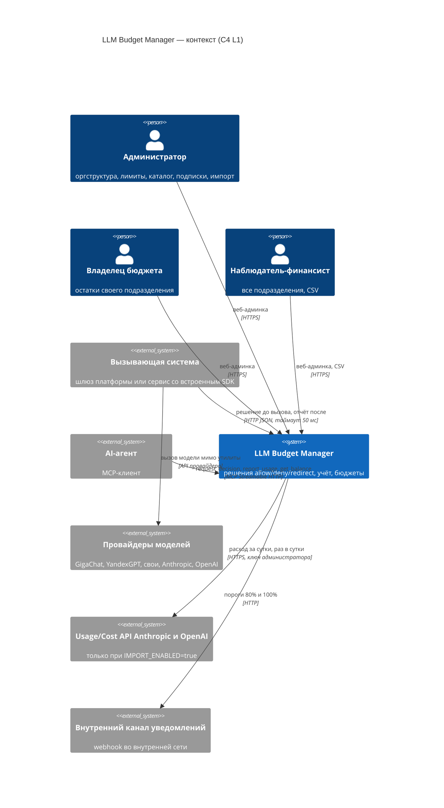
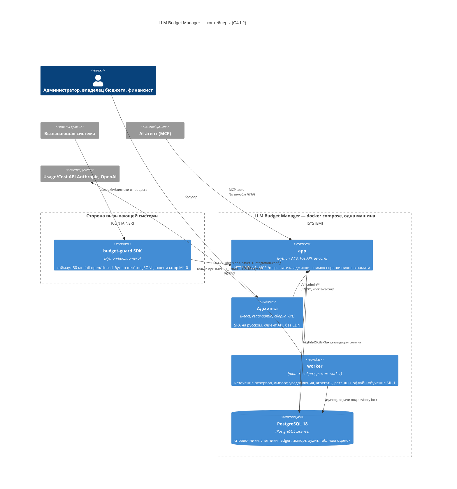

# 11. Архитектурное предложение (режим `ai`): LLM Budget Manager v1

**Автор:** архитектор AI. **Дата:** 2026-10-13. **Режим:** `ai` (скилл `architecture-proposal`), независимо от архитектора classic.
**Входы:** `10_tech_spec.md`, `10_constitution.md`, `10_tech_brief_for_architects.md`, `10_tech_qa.md`, выборочно `06_ceo_verdict.md`, `02_legal.md`, `02_certification.md`, `02_po.md`, `07_po_q11.md`.
**Пометки:** [Факт] со ссылкой, [Вывод] из входов и расчёта, [Гипотеза] — нужно проверить на спайке или пилоте.

---

## 1. Суть в 5 строк

1. **Что строим.** Один Python-сервис (FastAPI) и PostgreSQL в docker compose. Решение allow/deny/redirect принимается одной короткой транзакцией с блокировкой строк-счётчиков бюджета. Ведётся неизменяемый журнал проводок (ledger). Единый модуль `Balance` считает остаток по FR-026. Импорт Anthropic и OpenAI, ретеншн и задачи по расписанию выполняет отдельный контейнер `worker`. Вызывающая сторона подключается через эталонный SDK: fail-open 50 мс, буфер отчётов.
2. **Главная идея режима `ai`.** Критический путь решения полностью детерминирован (принцип VI). ML работает только **офлайн и в роли советника**: строит версионированные справочные таблицы оценок, а горячий путь читает их как обычный справочник. Каждая ML-функция включается флагом и имеет фолбэк без ML.
3. **Честный итог по ML.** В v1 ни LLM, ни GPU не нужны. Реальный выигрыш есть в двух местах. (а) Подсчёт входных токенов токенизатором **на стороне вызывающей системы** (ML-0): утилита получает только число, содержимое к ней не попадает. (б) После пилота — статистическая оценка выходных токенов для размера резерва (ML-1). Она снижает число ложных отказов на границе бюджета, а это метрика Г2. Прогноз исчерпания и аномалии спецификация исключила из v1. Подбор совместимых моделей, объяснение отказов и сопоставление источников импорта лучше решаются без ML.
4. **Стоимость MVP** [Вывод]: полный объём P1–P3 (без IdP) — 18,7 чел.-нед ≈ 4,32 чел.-мес ≈ **2,07 млн ₽**. Это выше рамки. После урезания по принципу VIII получается 16,8–17,6 чел.-нед ≈ 3,88–4,06 чел.-мес ≈ **1,86–1,95 млн ₽**. Ядро P1 без урезаний — 11,9 чел.-нед ≈ 2,75 чел.-мес. ML-1 после пилота — ещё 1,5 чел.-нед ≈ 0,17 млн ₽. Токены — 0 ₽, GPU — 0 ₽.
5. **Срок** [Вывод]: ≈ 8 календарных недель командой из 3 человек после согласия заказчика. До этого — спайк для Г1 на 3 дня архитектора (раздел 12.4).

---

## 2. Соответствие требованиям

Риск невыполнения: Н — низкий, С — средний, В — высокий.

| Требование | Как закрывается | Риск |
|---|---|---|
| FR-001, FR-002 | `POST /v1/decisions` и MCP `request_decision` вызывают один и тот же `DecisionEngine.decide()`. Коды отказа задаются одним `enum` в доменном модуле | Н |
| FR-003 | Перебираются все применимые счётчики (сотрудник и подразделение × день, неделя, месяц). Решение принимается по минимальному остатку, в ответе указан `limit_applied` | Н |
| FR-004 | Чистая функция `select_cheapest()`. Фильтр: разрешена субъекту, тип `chat`, набор возможностей ⊆ возможностей модели, `max_context ≥ required_context`, помещается во все лимиты. Сортировка: (оценка в ₽, `admin_order`, `model_id`). Эмбеддинги не перенаправляются никогда | Н |
| FR-005 | Режим политики подразделения. В режимах «наблюдать» и «предупреждать» ответ всегда «разрешить», в ответе и журнале стоит флаг `over_limit_observed` | Н |
| FR-006 | `fail_mode` хранится в политике и отдаётся через `GET /v1/integration-config`. SDK кэширует конфигурацию на диске. Эталонный SDK (Python) и описание протокола входят в поставку | С: вызывающие стороны могут не встроить SDK (R-5) |
| FR-007, FR-010 | Таблица `reservation` с `expires_at`. `worker` раз в 30 с закрывает просроченные резервы проводкой «нет отчёта» | Н |
| FR-008, FR-009 | Отчёт о расходе: уникальный ключ `ledger_entry(decision_id)`. Повтор возвращает `duplicate`. Цена берётся по `price_version_id`, зафиксированной в решении | Н |
| FR-011 | `POST /v1/reports:batch`. Ключ идемпотентности — `decision_id`, а без него — `(caller_id, client_report_id)`. SDK генерирует UUID при буферизации | Н |
| FR-012 | Загрузка CSV с полями «логин; группа; признак основной». Построчная валидация, сводка, история переводов `employee_membership` | Н |
| FR-013, FR-014 | Лимиты как набор (владелец, период, сумма). Периоды вычисляются в `Europe/Moscow` независимо от часового пояса сервера | Н |
| FR-015 | `model` + `model_price` (`valid_from`) + возможности + `admin_order`. Опционально — предзаполнение из файла цен LiteLLM (MIT), раздел 14 | Н |
| FR-016 | Ключ вызывающей системы — 256 бит, хранится только SHA-256. Ключ показывается один раз, его можно отозвать. Служебный ключ привязан к подразделению | Н |
| FR-017 – FR-020 | `subscription` + чистая функция `Amortizer`. Правило округления — раздел 5.4. `POST /subscriptions:preview` показывает долю бюджета до сохранения | Н |
| FR-021 – FR-025 | `worker` и адаптеры `UsageSource` (Anthropic, OpenAI, Recorded). Замена значений через версию строки импорта и сторно, раздел 5.5 | С: формат API, сутки UTC и МСК, R-4 |
| FR-026 | Единственная реализация — модуль `Balance`. Ночной инвариант: счётчики = Σ проводок | Н |
| FR-027, FR-028 | Админка на react-admin (MIT), русский словарь свой. CSV строится из агрегатов без сотрудников | С: объём фронтенда |
| FR-029 | `notification` с уникальным ключом (подразделение, лимит, период, порог), поэтому уведомление уходит ровно один раз. Канал «в админке» и webhook во внутреннюю сеть | Н |
| FR-030 – FR-032 | RBAC в сервисном слое, а не в UI. Аудит пишется в той же транзакции, что и изменение. Админка вызывает только публичный API | Н |
| FR-033 | Адаптер MCP (официальный SDK `mcp`, MIT) поверх тех же функций сервисного слоя | Н |
| FR-034, FR-035 | В схеме нет полей для текста. Псевдоним = HMAC-SHA256 от логина. Сопоставление в `employee_identity` доступно только администратору | Н |
| FR-036 | Детальные таблицы секционированы по месяцам, секции старше 12 месяцев удаляются. `daily_aggregate` хранится 36 месяцев | Н |
| FR-037 | `docker compose up -d`, `.env.example`, скрипты `backup.sh` и `restore.sh` | Н |
| SC-001 | Горячий путь: снимок справочников в памяти и одна транзакция на 3–4 оператора. Цифры подтверждаются спайком, раздел 9 | **С**: проверяется только замером |
| SC-002 | Отказной тест на эталонном SDK: `docker compose stop app worker db` под нагрузкой | Н |
| SC-003 | Ответ 2xx на отчёт отправляется только после COMMIT с `synchronous_commit=on` | Н |
| SC-004 | Гонок нет: решения по одному бюджету сериализуются блокировкой строк. Перерасход возможен только из-за отклонения факта от резерва и вызовов при fail-open, раздел 9.2 | Н |
| SC-005 | Отчёт сверки по источникам со способом «Decision API». Сутки UTC провайдера отличаются от суток МСК, раздел 5.5 | С |
| SC-006, SC-007 | Приёмочные тесты пишутся до кода. Деньги считаются в `Decimal`, хранятся в `NUMERIC`, правила округления зафиксированы | Н |
| SC-008 | Загрузка в 04:00 МСК (сутки UTC провайдера закончились в 03:00 МСК). Повтор каждый час до 12:00 | С: зависит от доступности провайдера |
| SC-009 | Один compose-файл, образы собираются заранее, миграции применяются при старте | Н |
| SC-010, SC-011 | Тест матрицы «роль × операция», проверка схемы и выборки журналов на отсутствие текста | Н |
| SC-012 | Перезапуск контейнеров при сбое и healthcheck. Сбой утилиты закрывается fail-open | С: один узел |
| SC-013 | Раздел 12, порядок урезания | **В** (R-1) |
| SC-014 | Вне приёмки. Агрегаты и метрики для замера Г3 есть | — |

---

## 3. Контекст и контейнеры (C4 L1–L2)

### 3.1. Контекст (L1)

### 3.2. Контейнеры (L2)

**Сети compose.** `app` и `db` подключены только к сети `core` с параметром `internal: true`, поэтому выхода наружу у них нет. `worker` подключается к сети `egress` только через профиль `import`: `docker compose --profile import up`. Без профиля у `worker` нет маршрута наружу, раздел 10.4.

**Сознательно отсутствуют:** Redis, брокер очередей, отдельный сервер моделей, GPU, Prometheus и Grafana в составе поставки (Grafana распространяется под AGPL). Причина — принцип VIII: ни одно требование этих компонентов не требует.

---

## 4. Компоненты и модули

Терминология — `codebase-design`. Цель — несколько **глубоких** модулей с маленьким интерфейсом. HTTP и MCP — тонкие адаптеры над ними.

### 4.1. Карта модулей

| Модуль | Интерфейс (кратко) | Что скрыто за ним | Шов для тестов |
|---|---|---|---|
| **DecisionEngine** | `decide(req: DecisionRequest) -> Decision`; `report(r: SpendReport) -> ReportResult`; `report_batch(list) -> list[ReportResult]` | Аутентифицированный субъект, снимок справочников, порядок блокировок, расчёт всех лимитов, выбор модели, резерв, идемпотентность, флаги «наблюдение», «решение не выполнено», «без решения» | Внутренний шов: чистая `evaluate(snapshot, balances, req, estimate) -> Verdict` без ввода-вывода. На неё ложатся все пограничные случаи сценария 1 как таблица тестов. Внешний шов — `decide()` на тестовой БД |
| **Balance** | `balances(owner_ids, at) -> list[LimitBalance]`; `breakdown(owner, period) -> Breakdown` | FR-026: факт, резервы, импорт по загруженным суткам, амортизация. Границы периодов по МСК, курс, округление, прослеживаемость до проводок | Сравнение с эталонным ручным расчётом (SC-007). Те же функции используют решения, админка, CSV и уведомления |
| **Ledger** | `post(entries, idem_key) -> Posted / Duplicate` | Append-only проводки, сторно, обновление счётчиков в той же транзакции, уникальные ключи | Тест идемпотентности, ночная сверка инварианта |
| **Amortizer** | `amortized(subs, owner, period, fx) -> Decimal` (чистая) | Помесячная разбивка недели, дни месяца, курс месяца или последний, «нет курса» | Чистые табличные тесты |
| **ImportPipeline** | `run(provider, day) -> ImportResult` | Пагинация, нормализация, версии строк, сторно и перепроводка, «не распределено», счётчик неудач, уведомления | Адаптеры `UsageSource`: `AnthropicSource`, `OpenAISource`, `RecordedSource` (записанные ответы). Это три адаптера, то есть реальный шов |
| **Catalog / OrgDirectory / Policies** | CRUD + `snapshot() -> Snapshot` | История цен, перевод сотрудников, основная группа | Через API |
| **TokenEstimator** (ML) | `estimate(model, caller, input_tokens?, input_chars?, max_output?) -> Estimate{in, out, source, version}` | Каскад: число от вызывающей стороны → таблица ML-1 (если флаг включён и таблица свежая) → значение по умолчанию из каталога | Два адаптера: `CatalogEstimator` (по умолчанию) и `QuantileTableEstimator` (ML-1). Детерминированный ответ при заданной версии таблицы |
| **AccessControl + Audit** | `authorize(principal, action, scope)`; аудит внутри сервисных функций | Роли, область подразделения, псевдонимы, запись отказов доступа | Матрица «роль × операция» (SC-010) |
| **Notifier** | `evaluate_thresholds(owner, period)`; каналы `InApp`, `Webhook` | Однократность по уникальному ключу, повтор доставки | Фейковый канал |
| **budget-guard SDK** | `with guard.call(subject, model, caps, messages=… / input_tokens=…) as d: … d.report(usage)` | Таймаут, fail-open или fail-closed по кэшу конфигурации, буфер JSONL с fsync, досылка пакетами, токенизация локально (ML-0) | Отказной тест SC-002 с `kill` утилиты |

### 4.2. Design It Twice: интерфейс решения

Сравнил три формы интерфейса ядра (`DESIGN-IT-TWICE.md`).

| Вариант | Интерфейс | Глубина | Вердикт |
|---|---|---|---|
| A. Один вызов | `decide(req) -> Decision`. Блокировки, выбор модели и резерв скрыты внутри | Высокая: вызывающая сторона знает одну операцию и три исхода | **Выбран** |
| B. Проверка и резерв раздельно | `check(req)`, затем `reserve(decision)` | Низкая: вызывающая сторона отвечает за порядок, между вызовами возможна гонка, SC-004 под угрозой | Отвергнут |
| C. Актор в памяти на бюджет | `decide()` над счётчиками в памяти, запись в БД асинхронно | Высокая, задержка минимальна | Отвергнут для v1: при падении теряются резервы, нужен лидер, сложнее SC-003. Запасной рычаг, если спайк не даст p95 |

### 4.3. Поток решения (горячий путь)

1. `app` находит ключ по хэшу в кэше, получает субъекта, подразделение и политику из снимка в памяти.
2. `TokenEstimator.estimate()` — поиск в памяти без ввода-вывода.
3. Транзакция: `SELECT … FROM budget_counter WHERE (owner, period_kind, period_start) IN (…) ORDER BY owner_id, period_kind FOR UPDATE`. Затрагивается до 6 строк, порядок фиксирован, поэтому взаимоблокировок нет.
4. Амортизация берётся из кэша `Amortizer` по (владелец, сутки). Кэш сбрасывается при изменении подписок или курса.
5. `evaluate()` — чистая функция, возвращает вердикт.
6. `INSERT decision`, `INSERT reservation`, `UPDATE budget_counter SET reserved = reserved + x`, затем `COMMIT`.

---

## 5. Данные

### 5.1. Сущности и хранение (PostgreSQL 18)

| Таблица | Ключевые поля | Примечание |
|---|---|---|
| `department` | id, name, policy_mode, fail_mode, allowed_models[] | группа AD |
| `employee` | id, pseudonym, active | без ФИО и e-mail |
| `employee_identity` | employee_id, ad_login | только роль «администратор» (FR-035) |
| `employee_membership` | employee_id, department_id, valid_from, valid_to | история переводов |
| `service_subject` | id, department_id, name | |
| `caller_system` | id, name, key_hash, key_prefix, department_id?, status, allowed_subject_scope | ключ хранится только как хэш |
| `limit_rule` | owner_type, owner_id, period_kind, amount_rub | |
| `model` | id, provider, kind, caps{tools,json,max_ctx}, admin_order, default_in_tokens, default_out_tokens | |
| `model_price` | id (price_version), model_id, valid_from, in_per_1k, out_per_1k, cached_in_per_1k?, currency | история цен (FR-015) |
| `fx_rate` | month, usd_rub, entered_by | |
| `budget_counter` | owner_type, owner_id, period_kind, period_start, fact_rub, reserved_rub, import_rub | горячая строка блокировки |
| `decision` | id (UUIDv7), caller_id, subject, dept_id, requested_model, final_model, outcome, code, reserve_rub, price_version_id, est_in, est_out, est_source, est_version, max_out, created_at | секции по месяцам |
| `reservation` | decision_id, amount_rub, expires_at, state | |
| `ledger_entry` | id, source_type (token / no_report / import / import_reversal), source_ref, owner_type, owner_id, model_id, spend_date_msk, amount_rub, orig_amount, orig_currency, fx, flags[], idem_key UNIQUE | append-only, секции по месяцам |
| `usage_fact` | decision_id?, in_tokens, out_tokens, cached_tokens, status | только числа |
| `subscription` | provider, plan, seat_price, currency, seats, start, end, assignee_type, assignee_id? | |
| `provider_source` | provider, source_kind (workspace / project / api_key), source_id, department_id, accounting (import / decision_api) | ровно один способ учёта (принцип VI) |
| `import_line` | provider, source_id, model, day, amount_orig, currency, amount_rub, version, status (posted / reconcile / unallocated), fetched_at | UNIQUE (provider, source, model, day, version) |
| `import_run` | provider, day, status, error, attempts | отставание и уведомление после 2 неудач |
| `notification` | dept, limit, period_start, threshold, channel, delivery_status | UNIQUE (dept, limit, period_start, threshold) |
| `admin_user`, `audit_log` | | аудит: кто, когда, объект, было, стало |
| `daily_aggregate` | day, dept_id, model_id, source_type, amount_rub, tokens | без сотрудников, 36 месяцев |
| `estimator_table` (ML-1) | version, caller_id?, model_id, q_out_p50, q_out_p95, q_out_p99, chars_per_token, n, trained_at, metrics_json, status (candidate / active / retired) | версионированный справочник |

### 5.2. Что не хранится

Текст запросов и ответов, системные промпты, имена инструментов из запросов, IP конечных пользователей, ФИО, ключи провайдеров. Из SDK приходит число `input_chars`. Это длина, а не содержимое [Вывод: не ПДн и не содержимое; подтвердить у юриста вместе с D5].

### 5.3. Жизненный цикл и объёмы

- **Объём** [Гипотеза]: 1 000 сотрудников × 100 вызовов в день = 100 тыс. решений в сутки. Решение, отчёт и проводка с индексами — порядка 0,5 КБ на вызов, то есть ≈ 50 МБ в сутки, ≈ 1,1 ГБ в месяц (22 рабочих дня), ≈ 13 ГБ за 12 месяцев. Верхняя граница — 50 rps 8 часов в день: ≈ 16 ГБ в месяц. Помещается на одном диске.
- **Ретеншн**: детальные секции старше 12 месяцев удаляются целиком командой `DROP PARTITION`. Агрегаты хранятся 36 месяцев. Обучающая выборка ML-1 — последние 90 дней метаданных [Гипотеза], внутри ретеншна.

### 5.4. Деньги и округление (SC-007)

- Все суммы считаются в `Decimal` (Python) и хранятся в `NUMERIC(18,2)` (₽). Цены — `NUMERIC(18,8)`. Плавающая точка нигде не используется.
- **Токенное событие:** `round_half_up(in/1000·p_in + out/1000·p_out + cached/1000·p_cached, 2)`. Цена в USD сначала переводится по курсу месяца. Округляется каждая проводка, остаток — точная сумма округлённых проводок.
- **Амортизация** (сверено с примером 4.1 спецификации): для периода P и месяца M `amort(P∩M) = round_half_up(total_M × days(P∩M, по сегодня включительно) / days_in(M), 2)`. Неделя на стыке месяцев — сумма по двум сегментам. Проверка: 7 500 × 10 / 31 = 2 419,35; 7 500 × 1 / 31 = 241,94. Оба значения совпадают со спецификацией. Следствие: сумма дневных значений может отличаться от месячного на копейки. Это норма правила, а не ошибка, и она описана в документации администратора.

### 5.5. Импорт

- **Anthropic** [Факт, [документация](https://platform.claude.com/docs/en/build-with-claude/usage-cost-api)]. `cost_report`: только сутки (`1d`), группировка `workspace_id` и `description` (из description разбирается модель), USD в центах, данные обычно появляются в течение ≈ 5 минут, есть пагинация. Стоимость Priority Tier в `cost_report` не входит. Разбивка по API-ключу есть только в `usage_report` (токены). [Вывод] Источник «workspace» — основной. Источник «API-ключ» Anthropic оценивается как токены × цена каталога с пометкой `estimated`.
- **OpenAI** [Факт, [справочник API](https://developers.openai.com/api/reference/resources/organization/subresources/audit_logs/methods/get_costs)]. `GET /organization/costs`, сутки (`1d`), `group_by`: `project_id`, `line_item`, `api_key_id` и др. Поля суммы в ответе сверить на спайке.
- **Сутки.** Сутки провайдера считаются по UTC (00:00–24:00 UTC = 03:00–03:00 МСК). [Вывод] Предлагаю относить сутки UTC провайдера к календарной дате МСК с тем же номером. Сдвиг на 3 часа влияет только на расхождение на стыке месяцев (SC-005). Это отклонение от буквы сценария 5.1 нужно подтвердить у техлида (открытый вопрос Q-A2). Альтернатива — почасовой `usage_report` × цена каталога — даёт не фактическую стоимость провайдера.
- **Замена, а не добавление (FR-024).** Строка `(provider, source, model, day)` перечитывается. Если сумма изменилась, создаётся `version+1`, а в одной транзакции проводятся сторно прежней проводки и новая проводка. Счётчики меняются на разницу. Данные за закрытый период попадают в счётчик **своего** периода и в текущий остаток не входят (сценарий 5.7).
- **Ровно один способ учёта.** `provider_source.accounting`: способ `import` проводится, способ `decision_api` получает статус `reconcile` и в счётчики не попадает. Несопоставленный источник получает статус `unallocated` и вызывает уведомление.

---

## 6. Контракт API (набросок OpenAPI)

Общие правила: JSON, UTF-8, время в ISO 8601 с `+03:00`, деньги — строками-десятичными (`"30.00"`). Ошибки — `application/problem+json` с машинным `code` на английском и `detail` на русском.

### 6.1. Для вызывающих систем (Bearer — ключ вызывающей системы)

| Метод и путь | Вход | Выход | Ошибки |
|---|---|---|---|
| `POST /v1/decisions` | `subject{type: employee/service, id}`, `model`, `kind: chat/embedding`, `input_tokens?`, `input_chars?`, `max_output_tokens?`, `caps{tools, json_mode, context_tokens}` | `200`: `decision_id`, `outcome: allow/redirect/deny`, `model`, `requested_model`, `code?` (`budget_exceeded`, `model_not_allowed`, `model_unknown`, `subject_unknown`), `reason`, `reserve_rub`, `limit_applied{owner, period, remaining_rub, reset_at}`, `estimate{in, out, source, version}`, `observed_over_limit`, `http_hint` (403/429), `expires_at` | `401`, `422`. Отказ по бюджету — штатный исход `200` с `outcome=deny` и `http_hint=429` [Вывод: одинаково для HTTP и MCP; шлюз сам отображает в 403/429] |
| `POST /v1/decisions/{id}/report` | `in_tokens`, `out_tokens`, `cached_tokens`, `actual_model`, `status: ok/aborted/error` | `status: posted/duplicate`, `charged_rub`, `flags[]` | `401`, `404`, `422` |
| `POST /v1/reports:batch` | `items[]{decision_id? / (client_report_id, subject, model), …}` | `results[]{status, charged_rub}` | `401`, `413` |
| `GET /v1/balance?subject=…` | | список `LimitBalance` | `401`, `403` |
| `GET /v1/integration-config` | `If-None-Match` | `timeout_ms`, `fail_mode` по подразделению или субъекту, `tokenizer_hints{model: {family, chars_per_token}}`, `version` | `401` |

### 6.2. MCP (Streamable HTTP, `/mcp`, тот же Bearer)

| Инструмент | Параметры | Результат |
|---|---|---|
| `request_decision` | как в `POST /v1/decisions` | тот же объект `Decision` (structured content) |
| `report_usage` | как в `…/report` + `decision_id` | тот же `ReportResult` |
| `get_balance` | `subject` | тот же список |

Семантика едина: оба адаптера вызывают `DecisionEngine` и `Balance` и сериализуют одну схему pydantic. Тест SC «MCP = HTTP» гоняет один и тот же набор сценариев через оба адаптера.

### 6.3. Админка (cookie-сессия + CSRF; RBAC в сервисном слое)

`POST /v1/admin/org/import` (CSV) → сводка; CRUD `/v1/admin/departments`, `/employees/{pseudonym}/limits`, `/models`, `/models/{id}/prices`, `/callers` (+ `POST …/{id}:revoke`), `/subscriptions` (+ `POST /subscriptions:preview`), `/fx-rates`, `/provider-sources`, `/users`; `GET /v1/admin/balances?department&period`, `GET /v1/reports/spend.csv?from&to`, `GET /v1/reports/reconciliation?month`, `GET /v1/admin/import/status`, `POST /v1/admin/import:run`, `GET /v1/admin/notifications`, `GET /v1/admin/audit`, `GET /v1/admin/pseudonyms/{p}` (только администратор).
ML (v1.1, только администратор): `GET /v1/admin/estimator` (активная версия, метрики, кандидат), `POST /v1/admin/estimator/{version}:activate`, `POST /v1/admin/estimator:disable`.

---

## 7. Стек

| Слой | Выбор | Лицензия, версия | Почему |
|---|---|---|---|
| Язык | Python 3.13 | PSF | В одном языке живут ядро, импорт, SDK, токенизаторы и ML-1. Команде из 3 человек не нужен второй бэкенд-язык. Хватит ли Python для p95 — проверяет спайк |
| HTTP | FastAPI + uvicorn | MIT [Факт: FastAPI 0.136.1, [depscope](https://mcp.depscope.dev/pkg/pypi/fastapi)]; uvicorn — BSD-3 [проверить в SCA] | Асинхронность, pydantic-схемы → OpenAPI 3.1 из кода |
| MCP | `mcp` (официальный Python SDK) | MIT, 1.27.x [Факт, [depscope](https://mcp.depscope.dev/pkg/pypi/mcp); 1.28.0 в [Arch](https://www.archlinux.org/packages/extra/any/python-mcp)] | Streamable HTTP, монтируется в то же приложение |
| Драйвер БД | asyncpg | Apache-2.0, 0.32.0 [Факт, [Meterian](https://insights.meterian.io/components/python/asyncpg/)] | **Не psycopg 3**: он под LGPL-3.0, которого нет в белом списке принципа V [Вывод, сверить с юристом] |
| Миграции | Alembic + SQLAlchemy Core | MIT | Только DDL и построитель запросов. Горячий путь пишется на ручном SQL |
| БД | PostgreSQL 18 | PostgreSQL License; актуальная ветка 18.x, поддержка до 14.11.2030 [Факт, [postgresql.org](https://www.postgresql.org/support/versioning)] | `FOR UPDATE`, секционирование, `NUMERIC`, `LISTEN/NOTIFY`, `uuidv7()`. Совместим с Postgres Pro для следующего этапа |
| Фронтенд | React + react-admin + MUI + Vite | MIT (Enterprise Edition react-admin платная и отдельная — не используем) [Факт, [marmelab](https://marmelab.com/react-admin/)] | CRUD-админка с минимальным своим кодом. Русский словарь пишем сами. Шрифты системные, CDN нет |
| Пароли | argon2-cffi | MIT [проверить в SCA] | argon2id |
| Метрики | prometheus-client (только эндпоинт `/metrics`) | Apache-2.0 [проверить в SCA] | Без сервера мониторинга в поставке |
| ML-0 (SDK) | tiktoken; HF `tokenizers` для open-weight моделей заказчика | tiktoken — MIT, 0.13.0 [Факт, [depscope](https://depscope.dev/pkg/pypi/tiktoken)]; tokenizers — Apache-2.0 [проверить в SCA] | Точный подсчёт для семейств OpenAI и open-weight. Файлы кодировок tiktoken упаковываются в SDK: по умолчанию библиотека скачивает их при первом вызове [Вывод, проверить на спайке] |
| ML-1 (worker, v1.1) | SQL `percentile_cont` + NumPy; LightGBM (квантильная регрессия) — только как челленджер | LightGBM — MIT [Факт, [AMD ROCm docs](https://rocm.docs.amd.com/projects/lightgbm/en/docs-26.01/about/license.html)] | Без GPU, обучение ночью на CPU |
| Нагрузочный тест (не в поставке) | Locust | MIT [проверить, [PyPI](https://pypi.python.org/pypi/locust)] | k6 не берём: AGPL |
| CI: SDL | Bandit (SAST), pip-audit и OSV-Scanner (SCA), Syft или CycloneDX (SBOM), pip-licenses и license-checker | Apache-2.0, MIT, BSD [проверить каждую в SCA] | ГОСТ Р 56939-2024 как процесс (`02_certification.md`). Semgrep CE не берём: LGPL |
| Поставка | Docker Engine + compose v2, образ `python:3.13-slim` | | Перенос на Astra Linux или РЕД ОС на следующем этапе — смена базового образа, кода под конкретную ОС нет |

**Иностранные облака и API в критическом пути отсутствуют.** Единственное исходящее направление — Usage/Cost API за флагом (принцип IV).

---

## 8. ML/AI: где даёт выигрыш, где нет

### 8.1. Сводная таблица кандидатов

| # | Кандидат | Даёт ли выигрыш по спецификации | Решение для v1 | Фолбэк без ML |
|---|---|---|---|---|
| **ML-0** | Подсчёт входных токенов до вызова | **Да.** Точнее резерв и ниже риск R-6. Утилита не видит содержимое, поэтому считать может только вызывающая сторона | **В MVP**, в SDK: tiktoken для семейств OpenAI, `tokenizer.json` для open-weight моделей заказчика, коэффициент «символы → токены» для Claude, GigaChat и YandexGPT | Значение по умолчанию из каталога (`default_in_tokens`) |
| **ML-1** | Оценка выходных токенов (квантили) для размера резерва | **Да, но только после пилота.** При резерве по `max_output_tokens` или по умолчанию каталога резерв завышен. На границе бюджета это ложные отказы и перенаправления, а их доля — метрика Г2 (`06_ceo_verdict.md` §8). В MVP истории ещё нет | **v1.1 за флагом `ESTIMATOR_MODE=quantile`**, по умолчанию `catalog`. Данные копятся с первого дня бесплатно: поля решения и отчёта уже есть | `CatalogEstimator` и `max_output_tokens` |
| ML-1b | Калибровка «символы → токены» по моделям без открытого токенизатора | Да, небольшой: уточняет ML-0 для Claude, GigaChat и YandexGPT | v1.1 вместе с ML-1. Коэффициент — медиана `actual_in / input_chars`, публикуется в `integration-config` | Консервативный коэффициент из конфигурации |
| ML-2 | Прогноз исчерпания бюджета | Возможен, но **спецификация исключила его из v1** («Вне объёма») | Не делаем. Агрегаты для него есть | Уведомления 80% и 100% (FR-029) |
| ML-3 | Аномалии расхода | Исключено из v1 | Не делаем. Если понадобится после Г3 — сначала робастная статистика (медиана и MAD по агрегатам подразделение × модель), а не ML | Пороги 80/100% |
| — | Классификация совместимости моделей ML-моделью | **Нет.** Возможности модели — факты каталога. Классификатор добавит ошибки туда, где нужна проверка вложенности множеств (принцип VI) | Детерминированный фильтр | — |
| — | LLM-ассистент для заполнения каталога | **Нет.** Около 30 моделей вводятся один раз. Точнее — предзаполнение из открытого файла цен LiteLLM (MIT), где есть `max_input_tokens`, `supports_function_calling`, `supports_response_schema`, `mode` [Факт, [docs.litellm.ai](https://docs.litellm.ai/docs/provider_registration/add_model_pricing)] | Опция, вне оценки | Ручной ввод |
| — | Сопоставление источников импорта с подразделениями (LLM или эмбеддинги) | **Нет.** Источников десятки, ошибка стоит денег, а несопоставленные и так попадают в «не распределено». Подсказки нечётким сравнением строк (rapidfuzz, MIT) — классика, и то не в MVP | Нет | Ручной справочник |
| — | Объяснение отказа LLM | **Нет.** Шаблоны на русском точнее и детерминированы (принцип IX) | Нет | — |
| — | Маршрутизация по качеству или сложности запроса | Исключено спецификацией, требует содержимого (принцип I) | Нет | — |

**Вывод.** LLM в рантайме v1 не используется вообще, GPU не нужен. Режим `ai` здесь — это дисциплина «ML как офлайн-советник с измеримым гейтом», а не «LLM везде». Если судья увидит в предложении classic то же детерминированное ядро, это ожидаемо: ценность режима `ai` — в ML-0, ML-1 и защите MCP-поверхности от агентов (8.5).

### 8.2. Выбор моделей с учётом регуляторики РФ

| Функция | Модель | Где работает | Почему допустимо |
|---|---|---|---|
| ML-0 | Токенизаторы (BPE-словари), не нейросети | Процесс вызывающей системы | Содержимое не покидает вызывающую сторону, в утилиту приходит только число. Внешних вызовов нет: файлы кодировок упакованы в SDK |
| ML-1 | Квантильная таблица (базовая линия); LightGBM `objective=quantile` (челленджер) | `worker`, CPU, офлайн | Только метаданные (токены, модель, вызывающая система) без сотрудников. Веса и таблица — наши данные. Иностранных сервисов нет |
| Если в будущем понадобится LLM (не в v1) | Только локальная open-weight модель (например, Qwen3-4B или 8B, Apache-2.0 [Факт, [Interconnects](https://www.interconnects.ai/p/qwen-3-the-new-open-standard)]) через llama.cpp (MIT [Факт, [ROCm docs](https://rocm.docs.amd.com/projects/llama-cpp/en/latest/about/license.html)]) или российские облака (GigaChat, YandexGPT) по договору заказчика | On-prem | Anthropic и OpenAI как модели для утилиты **запрещены** принципом IV: исключение касается только API расхода. Веса в дистрибутив не включаем (`02_legal.md` §3.3) |

### 8.3. План оценки качества

**ML-0, токенизатор.**
- Эталонный набор: 200 синтетических запросов без ПДн на каждое семейство токенизатора [Гипотеза: объём]. Тексты на русском и английском, с инструментами и без. Источник истины — `usage.input_tokens` из ответа провайдера на тестовом ключе (раз, на спайке и при обновлении SDK).
- Метрика: относительная ошибка `|est − actual| / actual`.
- Пороги [Гипотеза, уточнить по спайку]: точные токенизаторы — p95 ошибки ≤ 5% (служебные токены чат-разметки дают небольшую разницу). Коэффициент «символы → токены» — медиана ошибки ≤ 15%, при этом оценка смещена вверх (недооценка ≤ 10% случаев).

**ML-1, оценка выходных токенов** (гейт включения флага):
- Данные: пары (решение, отчёт) пилота. Деление по времени: обучение на неделях 1…N−2, проверка на последних 2 неделях. Минимум выборки на ячейку (вызывающая система × модель) — n ≥ 200 [Гипотеза]. Ниже порога — переход к уровню модели, затем к каталогу.
- Метрики:
  1. **Покрытие** — доля вызовов, где фактическая стоимость ≤ резерва. Порог ≥ 98%.
  2. **Раздувание резерва** — Σ резервов / Σ факта. Сравнивается с базовой линией; цель — снижение, конкретный порог задаётся после замера базовой линии на пилоте.
  3. **Перерасход в повторе** — прогон журнала пилота через `evaluate()` с новыми резервами при лимитах пилота. Порог ≤ 1% лимита, то есть половина допуска SC-004.
  4. **Доля ложных отказов и перенаправлений в повторе** — отказ, при котором факт поместился бы в остаток. Должна быть ниже базовой линии.
- Правило: таблица активируется только при выполнении 1, 3 и 4. LightGBM заменяет квантильную таблицу, только если улучшает метрику 2 не менее чем на 10% при выполнении 1 и 3 [Гипотеза: порог полезности]. Иначе остаётся таблица: она проще и объяснима.
- Мониторинг после активации: ежедневно покрытие за вчера. Падение ниже 97% — автоматический откат на `catalog` и уведомление администратору.

### 8.4. Защита от «галлюцинаций» ML-контура

Генеративных моделей в рантайме нет, поэтому классических галлюцинаций нет. Аналог для ML-1 — неверная оценка. Защита:
1. Ограничение сверху: `reserve_out = min(max_output_tokens, q_p99)`, если вызывающая сторона передала `max_output_tokens`. Без него — `q_p99`, но не ниже значения по умолчанию из каталога × 0,5 [Гипотеза].
2. Объяснимость: в ответе есть `estimate.source` и `estimate.version`, решение воспроизводится по версии таблицы.
3. Свежесть: таблица старше 7 дней → фолбэк на `catalog` [Гипотеза].
4. Фактическая сумма всегда списывается по отчёту, оценка влияет только на резерв.

### 8.5. Защита от инъекций и недобросовестных агентов (MCP)

Сама утилита содержимое не читает, поэтому промпт-инъекция против неё как против LLM невозможна. Но MCP-клиенты — это LLM-агенты, и их можно склонить к подмене параметров. Меры:
1. **Привязка субъектов к ключу.** `caller_system.allowed_subject_scope`: служебный ключ — только свой служебный субъект, ключ агента — только перечисленные сотрудники или подразделение. Чужой субъект → `403` и запись в аудит. Агент не может тратить чужой бюджет, даже если его «уговорили».
2. **Только три инструмента, без админских.** Изменить лимит, каталог или ключи через MCP нельзя.
3. **Ответы инструментов — структурированные данные.** Свободный текст, введённый администратором (названия подразделений и моделей), отдаётся экранированным, с ограничением длины и без markdown. Описания инструментов статические, из кода.
4. **Модель берётся только из каталога.** Выдуманный агентом идентификатор модели → `model_unknown`. Цена всегда из каталога, а не от агента.
5. **Заниженный отчёт агента** обнаруживается сверкой с импортом (SC-005), а для открытых резервов — по флагу «решение не выполнено».
6. Защита админки: CSRF, `Content-Security-Policy` без внешних источников, экранирование всех строк из CSV AD (защита от CSV-инъекции при выгрузке: префикс `'` для значений, начинающихся с `= + - @`).

### 8.6. Поведение при недоступности ML

| Отказ | Поведение |
|---|---|
| Нет таблицы ML-1, флаг выключен, таблица устарела или не прошла гейт | `CatalogEstimator`, в ответе `estimate.source=catalog` |
| В SDK нет токенизатора для модели | Коэффициент символов из `integration-config`, иначе значение по умолчанию из каталога |
| Ночное обучение упало | Активная версия остаётся, уведомление администратору. На решения не влияет |

### 8.7. Стоимость ML

| Статья | На запрос | В месяц | Логика |
|---|---|---|---|
| Токены внешних LLM | 0 ₽ | 0 ₽ | LLM не используется |
| GPU | 0 ₽ | 0 ₽ | Нет инференса нейросетей |
| CPU ML-0 | доли мс у вызывающей стороны [Гипотеза, замерить] | — | Токенизация на стороне клиента |
| CPU ML-1 | 0 (поиск в словаре) | Минуты CPU ночью [Гипотеза] | Квантили по ≤ 90 дням метаданных |
| Разработка ML-1 | — | Разово 1,5 чел.-нед ≈ 0,17 млн ₽ | 1,5 / 4,33 × 0,48 [Вывод] |

---

## 9. Нефункциональные требования

### 9.1. Производительность (SC-001)

- **Эталонный стенд** (фиксирую): x86_64, 4 vCPU, 8 ГБ RAM, NVMe SSD ≥ 50 ГБ, Linux, Docker Engine + compose v2. Нагрузочный генератор работает на той же машине с ограничением в 1 vCPU. Обоснование: это минимальная типовая машина разработчика или ВМ пилота. Рабочий набор (снимок справочников на 1 000 сотрудников и 30 моделей, горячие счётчики) занимает мегабайты [Вывод], основной расход — сеть и fsync коммита.
- **Как достигается:** справочники в памяти, инвалидация через `LISTEN/NOTIFY`; одна транзакция; пул asyncpg с подготовленными запросами; 2 воркера uvicorn [Гипотеза: подобрать на спайке]; оценка токенов — поиск в словаре.
- **Цифр производительности не привожу**, их даст спайк (12.4). Рычаги на случай, если p95 > 10 мс: (1) `SET LOCAL synchronous_commit = off` только для транзакции решения. Риск — потеря резервов последних миллисекунд при аварии ОС, то есть малый перерасход. Отчёты остаются синхронными, SC-003 сохраняется. (2) Вариант C из 4.2.

### 9.2. Корректность денег (SC-004)

**Гарантия:** параллельность не даёт перерасхода. Решения, затрагивающие один и тот же счётчик, сериализуются `FOR UPDATE`. Каждое решение видит резервы всех предыдущих. Перерасход возможен только по трём причинам. (1) Факт превысил резерв: вызывающая сторона занизила вход или не передала `max_output_tokens`. (2) Вызов при fail-open. (3) Поздний импорт или подписка — это не перерасход решения, а видимый минус.
**Проверка:** тест сценария 2.5 — 3 экземпляра SDK, 50 одновременных запросов на границе, отчёты равны оценке ± случайное отклонение. Утверждение: перерасход ≤ 2% лимита. Плюс отдельный тест на нулевой перерасход при отчётах, равных оценке.

### 9.3. Надёжность

- SC-003: отчёт подтверждается только после `COMMIT` с синхронной записью. Проверка — `docker kill app` под нагрузкой и сверка ответов 2xx с проводками.
- SC-002: SDK использует таймаут 50 мс, кэширует конфигурацию на диске, ведёт буфер JSONL с fsync и досылает отчёты пакетами по 500 с экспоненциальной паузой. Ключ идемпотентности гарантирует отсутствие дублей.
- Импорт изолирован в `worker`: его сбой не трогает `app` (принцип III).
- `restart: unless-stopped`, healthcheck. Резервные копии — ночной `pg_dump -Fc` в отдельный том и инструкция `restore.sh`. Перед релизом проводится тест восстановления. RPO для настроек и истории — 24 часа [Гипотеза: для пилота достаточно; при необходимости — WAL-архив].
- SC-012 (99,5% в рабочее время) на одном узле держится перезапуском контейнеров. Работа AI не останавливается благодаря fail-open.

### 9.4. Наблюдаемость

Структурированные JSON-логи с `request_id`. Фильтр-редактор вырезает заголовки `Authorization` и `x-api-key` и значения переменных `*_ADMIN_KEY`. Тест: поиск ключей в логах после прогона. Эндпоинт `/metrics`: `decision_latency_seconds` (гистограмма), `decisions_total{outcome,code}`, `reports_total{status}`, `reservations_expired_total`, `import_lag_hours`, `estimator_source_total{source}`, `ledger_invariant_ok`. Страница «Состояние» в админке показывает импорт, отставание, инвариант и версию оценщика. Трассировки (OpenTelemetry) в v1 нет — принцип VIII.

### 9.5. Масштабирование

v1 рассчитан на одну машину. Путь дальше без переделки: несколько реплик `app` за балансировщиком (состояние в PostgreSQL, снимок инвалидируется `NOTIFY`), `worker` в одном экземпляре под advisory lock, перенос в Kubernetes. На вырост сейчас ничего не делаем.

---

## 10. Безопасность и регуляторика

### 10.1. Доступ

- Ключи вызывающих систем: 32 случайных байта с префиксом `bm_`. Хранится SHA-256, ключ показывается один раз, есть отзыв и аудит.
- Админка: локальные учётные записи (argon2id), cookie-сессия `HttpOnly; SameSite=Strict`, CSRF-токен, блокировка после 10 неудачных попыток [Гипотеза]. IdP (OIDC) — P3, вне оценки.
- RBAC в сервисном слое. Владелец бюджета видит только своё подразделение и псевдонимы. Финансист видит все подразделения без сотрудников и только на чтение. Попытка запрещённого доступа пишется в аудит (FR-031).

### 10.2. Секреты (принцип II)

`ANTHROPIC_ADMIN_KEY`, `OPENAI_ADMIN_KEY`, `PSEUDONYM_HMAC_KEY`, `SESSION_SECRET` передаются только через переменные окружения или Docker secrets (`/run/secrets`). В БД, логах, UI, ответах API и `pg_dump` их нет. Админка показывает только «ключ задан / не задан». Права ключей минимальны: у OpenAI — ключ администратора только на чтение, если доступно [проверить на спайке].

### 10.3. Шифрование

Внутри одной машины TLS не используется. Для доступа из сети — TLS на обратном прокси заказчика (ГОСТ-TLS по требованию — инфраструктура заказчика). Шифрование диска и резервных копий — средствами заказчика. Скрипт резервного копирования поддерживает шифрование `openssl enc` (Apache-2.0).

### 10.4. Без интернета (принцип IV) — двойная гарантия

1. **Сеть:** `app` и `db` подключены только к сети с `internal: true`. `worker` попадает в сеть `egress` только с профилем `import`.
2. **Код:** фабрика HTTP-клиента отказывает в соединении, если `IMPORT_ENABLED != true`, и проверяет хост по списку разрешённых (`api.anthropic.com`, `api.openai.com`).
3. **Тест:** при выключенном флаге выполняется полный прогон и `tcpdump` или `ss` в контейнерах → 0 исходящих соединений за пределы `core`. Отдельно проверяется отсутствие внешних шрифтов и CDN в сборке SPA.

### 10.5. 152-ФЗ и ТК РФ

Псевдонимизированные данные сотрудников остаются ПДн. Оператор — заказчик, обработка внутренняя, уровень защищённости ориентировочно УЗ-4 (`02_legal.md`). Минимизация: логин хранится только в `employee_identity`, ФИО нет. Трансграничной передачи ПДн импорт не создаёт: наружу уходят ключ администратора и параметры запроса, обратно приходят суммы по workspace и проектам [Вывод; подтверждение юриста по D5]. Названия API-ключей у провайдеров могут содержать имена людей → в справочнике хранится `source_id`, отображаемое имя — только у администратора [Вывод]. До режима «ограничивать» нужен локальный акт (зависимость, а не функция).

### 10.6. Безопасная разработка и лицензии

ГОСТ Р 56939-2024 как процесс: SAST, SCA, SBOM, проверка лицензий в CI на каждом релизе, реестр уязвимостей, модель угроз (MVP-уровень). Белый список лицензий проверяется автоматически, сборка падает на GPL, AGPL, SSPL и LGPL (последнее — до решения юриста). LiteLLM как код не используется. Если включим предзаполнение каталога, файл цен LiteLLM (MIT, вне `enterprise/`) копируется с NOTICE.

**AI-ассистированная разработка.** ИИ-ассистенты при написании кода сокращают срок [Гипотеза: в оценку не заложено], но создают два риска. (1) Права: код должен иметь автора-человека и проходить ревью, иначе цепочка прав для реестра под вопросом (ст. 1228 ГК) [Вывод; вопрос юристу]. (2) Конфиденциальность: в иностранные ассистенты не передаются секреты и данные пилота. Код утилиты — допустимо ли передавать — решает заказчик [Вывод].

---

## 11. Стоимость владения (3 года)

Ставка 0,48 млн ₽ за чел.-мес. (`06_ceo_verdict.md` §2). 1 чел.-мес = 4,33 чел.-нед (52 / 12) [Вывод].

| Статья | Год 1 | Год 2 | Год 3 | Итого | Логика |
|---|---|---|---|---|---|
| Разработка MVP до Г2 | 1,86–2,07 | — | — | 1,86–2,07 млн ₽ | 16,8–18,7 чел.-нед (раздел 12) |
| ML-1 после пилота (опция) | 0,17 | — | — | 0,17 млн ₽ | 1,5 чел.-нед, только при прохождении гейта данных |
| Сопровождение 0,25 FTE | 1,44 | 1,44 | 1,44 | 4,32 млн ₽ | 0,12 млн ₽/мес — допущение движка (`06_ceo_verdict.md` §8) [Гипотеза]. Год 1 считаю полным для запаса |
| Инфраструктура | по тарифу заказчика | | | — | Одна ВМ 4 vCPU / 8 ГБ / 100 ГБ SSD или существующий сервер [Гипотеза]. Цен не привожу: их нет во входах |
| Лицензии ПО | 0 | 0 | 0 | 0 | Только OSS из белого списка |
| Модели, токены, GPU | 0 | 0 | 0 | 0 | Раздел 8.7 |
| SDL-инструменты | 0 | 0 | 0 | 0 | Бесплатные. Трудозатраты AppSec — в SDL платформы, оно уже есть (Q2 CEO) |
| **Итого** | | | | **≈ 6,2–6,6 млн ₽ + инфраструктура** | [Вывод]. Пересчёт экономики «lite-утилиты» — у финансиста через движок (D2) |

---

## 12. План MVP

### 12.1. Оценка по ролям (чел.-недели) [Вывод: экспертная оценка, без учёта ускорения ИИ-ассистентами]

| Блок | Роль | Чел.-нед | Приоритет |
|---|---|---|---|
| B1. Каркас, схема, миграции, ключи вызывающих систем, каркас аудита | Backend | 1,5 | P1 |
| B2. Загрузка AD-файла, каталог с историей цен, лимиты и политики | Backend | 1,5 | P1 |
| B3. DecisionEngine, Balance, Ledger, резервы, выбор модели, правила денег | Backend | 3,0 | P1 |
| B4. Отчёты, идемпотентность, пакетная досылка, истечение резервов | Backend | 1,0 | P1 |
| B5. Подписки, курс, амортизация, предупреждения и предпросмотр | Backend | 1,0 | P2 |
| B6. Импорт: Anthropic 1,0, OpenAI 0,8, справочник, сверка, «не распределено» 0,5 | Backend | 2,3 | P2 |
| B7. Роли и учётные записи 0,7, уведомления в админке 0,3, внешний канал 0,3, CSV и ретеншн 0,3 | Backend | 1,6 | P1/P2 |
| B8. MCP-адаптер и тест эквивалентности | Backend | 0,5 | P3 |
| S1. SDK: fail-open, буфер, досылка 0,7 + ML-0 токенизация 0,3 | Backend/ML | 1,0 | P1 (+ ML-0) |
| F1. Админка на react-admin, русский словарь, панели остатков | Frontend | 2,0 | P1/P2 |
| D1. Compose, сети, резервное копирование, CI (SCA, SBOM, лицензии) | DevOps | 1,0 | P1 |
| Q1. Нагрузочный, отказной, матрица ролей, тест «нет содержимого», тест egress | QA | 1,5 | P1 |
| U1. Макеты экранов админки (минимум) | Дизайн | 0,3 | P1 |
| A1. Архитектор и техлид: контракт, ревью | Архитектор | 0,5 | P1 |
| **Итого полный объём** | | **18,7** | ≈ 4,32 чел.-мес ≈ 2,07 млн ₽ |
| *В т.ч. ядро P1* | | *11,9* | *≈ 2,75 чел.-мес ≈ 1,32 млн ₽* |

Приёмочные тесты сценариев пишутся внутри блоков до кода (принцип VII). Q1 — это отдельные системные тесты.

### 12.2. Урезание (принцип VIII) — показываю, что войдёт

Свою добавку (ML-0) урезаю **первой**, раньше пунктов спецификации.

| Шаг | Что убираем | Чел.-нед | Чел.-мес | Млн ₽ | Рамка |
|---|---|---|---|---|---|
| 0 | — | 18,7 | 4,32 | 2,07 | вне рамки |
| 1 | ML-0 в SDK (−0,3) | 18,4 | 4,25 | 2,04 | вне рамки |
| 2 | MCP (−0,5), IdP и так не в оценке | 17,9 | 4,13 | 1,98 | ≤ 2 млн ₽, но > 4,0 чел.-мес |
| 3 | Внешний канал уведомлений (−0,3) | 17,6 | 4,06 | 1,95 | ≤ 2 млн ₽, на грани 4,0 чел.-мес |
| 4 | Коннектор OpenAI (−0,8) | **16,8** | **3,88** | **1,86** | **в рамке по обоим критериям** |

**Честно:** полностью в SC-013 (≤ 4 чел.-мес **и** ≤ 2 млн ₽) помещается только шаг 4, и запаса там почти нет: 0,12 чел.-мес. P1 при любом шаге сохраняется целиком. Предлагаю техлиду и заказчику решение заранее: стартуем с полным планом, замер темпа — после этапа Э2 (неделя 5). Если прогноз выше 17,6 чел.-нед, урезаем по шагам 1–4. Ускорение от ИИ-ассистентов — резерв, а не план.

### 12.3. Этапы и критический путь (команда: 2 backend, один с ML-навыками; 1 frontend/fullstack на ~0,5; DevOps и QA — 1 человек на ~0,5)

| Этап | Недели | Содержание | Выход |
|---|---|---|---|
| Э0 | до старта | Спайк Г1 (12.4), `12_openapi.yaml` у главного архитектора | Замеры p95, импорт на тестовых ключах |
| Э1 | 1–2 | B1, D1, красные приёмочные тесты P1, U1 | Compose поднимается, CI зелёный на SCA и SBOM |
| Э2 | 2–5 | B2, B3, B4, S1 → нагрузочный и отказной тест | **Сценарии 1–2 зелёные, SC-001, SC-002, SC-004** |
| Э3 | 4–7 | B5, B6, B7, F1 | Сценарии 3–6 |
| Э4 | 7–8 | B8 (MCP), полный Q1, документация, проверка восстановления | Готовность к Г2 |

**Критический путь:** схема → Ledger и Balance → DecisionEngine → SDK и отказной тест → нагрузочный тест SC-001/SC-004 → QA-гейт. Импорт и админка идут параллельно ему.

### 12.4. Технический спайк вместо прототипа LiteLLM (ответ на D3), ≤ 3 дня архитектора

| День | Что | Критерий «дальше» |
|---|---|---|
| 1 | Минимальный `POST /v1/decisions`: FastAPI + asyncpg + PostgreSQL 18, `FOR UPDATE` на счётчиках, резерв. Locust 50 rps на эталонном стенде + 50 одновременных запросов на границе лимита | p95 внутри утилиты ≤ 10 мс, p99 ≤ 25 мс, добавленная задержка у клиента p95 ≤ 20 мс; перерасход 0 при отчётах = оценке. Если не выполняется — рычаги 9.1 и повторный замер |
| 2 | Тестовые ключи администратора: Anthropic `cost_report` + `usage_report`, OpenAI `/organization/costs` + usage. Нормализация в `import_line`, повторная загрузка, проверка суток UTC и выравнивания `start_time`, поля суммы OpenAI | Строки за сутки D сходятся с консолью провайдера; повторная загрузка не меняет итогов; данные за D доступны до 12:00 МСК D+1 |
| 3 | Прототип SDK: таймаут 50 мс, fail-open, буфер, `kill` утилиты; tiktoken офлайн (упакованные кодировки) на 20 запросах против `usage` | 100% вызовов при остановке проходят; 100% досылки без дублей. Отчёт по Г1 |

Финансовый критерий Г1 (расход ≥ 18 млн ₽ в год) остаётся без изменений.

---

## 13. Риски и меры

| # | Риск | Вероятность | Влияние | Мера |
|---|---|---|---|---|
| A-1 | Трудоёмкость выше рамки (R-1) | Высокая | Высокое | Ядро P1 — 11,9 чел.-нед. Урезание заранее по 12.2, замер темпа на неделе 5. react-admin вместо своей вёрстки |
| A-2 | Python и PostgreSQL не дают p95 ≤ 10 мс | Средняя | Высокое | Спайк день 1, рычаги 9.1. Последний рычаг — вариант C. Переход на другой язык — только если спайк провален |
| A-3 | Сутки UTC провайдера и сутки МСК → расхождение на стыке месяцев больше 2% (SC-005) | Средняя | Среднее | Q-A2 техлиду. Сверка за месяц обычно мала на краях [Гипотеза]. Альтернатива — почасовой usage × цена |
| A-4 | Формат API провайдеров изменится или ключ отзовут (R-4) | Средняя | Среднее | Адаптеры `UsageSource`, `RecordedSource` в тестах, уведомление после 2 неудач, импорт отделён от решений |
| A-5 | ML-1 завышает или занижает резерв → перерасход | Низкая (флаг и гейт) | Среднее | По умолчанию выключен. Гейт 8.3, ограничение `max_output_tokens`, автоматический откат при покрытии < 97% |
| A-6 | ML-1 сочтут «вероятностной логикой» в критическом пути (принцип VI) | Средняя | Среднее | Таблица детерминирована и версионирована, источник в ответе, факт всегда по отчёту. До включения — письменное толкование техлида в `10_tech_qa.md`. Без него ML-1 не включаем |
| A-7 | Вызывающие стороны не встраивают SDK или занижают оценку (R-5, R-6) | Высокая | Высокое | Готовый SDK, флаг «решение не выполнено», сверка с импортом, привязка субъектов к ключам (8.5) |
| A-8 | Утечка ключей администратора провайдеров (R-7) | Низкая | Критическое | 10.2, фильтр логов, тест, egress только у `worker` |
| A-9 | Лицензия транзитной зависимости вне белого списка | Средняя | Среднее | Проверка лицензий в CI ломает сборку. asyncpg вместо psycopg |
| A-10 | Правило округления амортизации (дни ≠ месяц на копейки) вызовет вопросы финансиста | Средняя | Низкое | Правило в документации, пример в тестах, подтверждение техлида |

---

## 14. Отвергнутые альтернативы

| Альтернатива | Почему нет |
|---|---|
| LLM или эмбеддинги в рантайме (совместимость, объяснения, сопоставление источников) | Нет выигрыша по требованиям, добавляет недетерминизм (принцип VI), локальная модель требует ресурсов, иностранные API запрещены (принцип IV) |
| Подсчёт токенов в утилите по тексту запроса | Нарушает принцип I: утилита увидела бы содержимое |
| `count_tokens` API провайдеров из SDK ([Anthropic](https://platform.claude.com/docs/en/build-with-claude/token-counting)) | Лишний сетевой вызов до вызова модели съест бюджет задержки. Для Claude полезно только офлайн, для калибровки коэффициента на спайке |
| ML-прогноз исчерпания и аномалии в v1 | Исключено спецификацией, данных ещё нет |
| Redis для счётчиков, Kafka для событий | Лишние контейнеры, два источника истины для денег. Блокировок в PostgreSQL хватает на 50 rps [Гипотеза → спайк] |
| Раздельные `check()` и `reserve()` | Гонки, мелкий интерфейс (4.2) |
| Счётчики в памяти с асинхронной записью | Риск SC-003 и сложность. Оставлен как рычаг |
| LiteLLM proxy или его бюджеты | Заказчик выбрал «вызов моделей отдельно», бюджеты LiteLLM работают только для трафика через прокси (D1) |
| Go или Rust ради задержки | Без замера это преждевременно. Второй язык в команде из трёх человек дороже. Решение — по спайку |
| ClickHouse или OLAP для отчётов | 13 ГБ в год PostgreSQL обслуживает с агрегатами |
| psycopg 3, k6, Grafana, Semgrep CE | LGPL или AGPL вне белого списка |
| Свой фронтенд с нуля | Дороже react-admin по объёму CRUD-экранов [Вывод] |

---

## 15. ADR

**ADR-AI-1. Детерминированное ядро, ML только как офлайн-советник за флагом.**
Контекст: принцип VI запрещает вероятностную логику в критическом пути, а режим `ai` требует искать выигрыш от ML. Решение: горячий путь читает только версионированные справочные таблицы. Модели обучаются ночью в `worker`. Каждая ML-функция имеет флаг, по умолчанию выключенный, гейт качества и фолбэк `catalog`. Последствия: ML не может сломать решение, а включение требует данных пилота и толкования техлида (A-6).

**ADR-AI-2. PostgreSQL как единственное хранилище, сериализация решений блокировками строк-счётчиков.**
Контекст: SC-004 (≤ 2%), SC-003, рамка простоты. Решение: `budget_counter` по (владелец, период) блокируется `FOR UPDATE` в фиксированном порядке. Решение, резерв и счётчик меняются в одной транзакции. Последствия: параллельность не даёт перерасхода. p95 зависит от задержки коммита → спайк. Redis и брокер не нужны.

**ADR-AI-3. Append-only ledger + счётчики + единый модуль `Balance`.**
Контекст: FR-026, SC-007, прослеживаемость (принцип VI). Решение: любое списание — проводка с идемпотентным ключом и ссылкой на основание. Уточнения — только сторно и новая проводка. Счётчики — производная проводок, ночью проверяется инвариант. Амортизация вычисляется правилом 5.4. Последствия: одна реализация остатка для решений, UI, CSV и уведомлений. Правка истории невозможна.

**ADR-AI-4. Оценка токенов на стороне вызывающей системы, в утилиту приходят только числа.**
Контекст: принцип I и риск R-6. Решение: SDK считает `input_tokens` токенизатором (ML-0) или передаёт `input_chars`. Утилита хранит только числа. Последствия: точнее резерв без доступа к содержимому. Нужно поставлять и обновлять SDK. Для не-Python клиентов — описание протокола и коэффициенты в `integration-config`.

**ADR-AI-5. Исходящие соединения возможны только из `worker` и только с профилем `import`.**
Контекст: принцип IV требует проверяемый ноль исходящих соединений при выключенном флаге. Решение: изоляция на уровне сети Docker (`internal: true`), список разрешённых хостов в коде и тест. Последствия: импорт нельзя случайно включить в `app`. При переносе в Kubernetes то же правило выражается через NetworkPolicy.

**ADR-AI-6. MCP — тонкий адаптер над тем же сервисным слоем, субъекты привязаны к ключу.**
Контекст: FR-033 (единая семантика), MCP-клиенты — LLM-агенты, их можно склонить к подмене параметров. Решение: три инструмента, общие pydantic-схемы и `DecisionEngine`, `allowed_subject_scope` на ключе, никаких админских операций. Последствия: тест эквивалентности HTTP и MCP. Если MCP урежут (шаг 2), удаляется один модуль, а не логика.

### Открытые вопросы техлиду

- **Q-A1.** Цена модели в USD, курс не вводился ни разу. Предложение: модель исключается из выбора, при прямом запросе — отказ `model_unknown` с `detail=no_fx_rate`, администратор видит ошибку.
- **Q-A2.** Отнесение суток UTC провайдера к дате МСК (5.5).
- **Q-A3.** Толкование принципа VI для ML-1 (A-6).
- **Q-A4.** Отказ по бюджету как HTTP `200` с `outcome=deny` и `http_hint`, а не как статус 403 или 429 (6.1).

---

## 16. Самооценка по матрице судьи (веса из `10_tech_brief_for_architects.md`)

| Критерий | Вес | Балл | Взвешено | Аргумент |
|---|---|---|---|---|
| Соответствие требованиям | 25 | 4 | 100 | Все FR P1–P2 и MCP закрыты. Минус — сутки импорта (Q-A2) и SC-001, который подтверждается только замером |
| Риск реализации | 15 | 4 | 60 | Корректность денег держится на простых проверенных механизмах (блокировки, ledger, Decimal). ML вынесен из критического пути, поэтому риск качества моделей почти нулевой |
| Время до MVP | 20 | 3 | 60 | Полный объём на 8% выше рамки. В рамку попадает только после урезания до шага 4, запас 0,12 чел.-мес |
| Стоимость владения 3 года | 15 | 4 | 60 | 0 ₽ на лицензии, токены и GPU, три контейнера. Сопровождение — по допущению движка |
| Регуляторика и безопасность | 10 | 5 | 50 | Содержимого нет по построению, двойная гарантия отсутствия интернета, ключи только в окружении, белый список лицензий с автопроверкой, защита MCP от агентов |
| Эксплуатация | 10 | 4 | 40 | Один compose, fail-open с SDK, видимое отставание импорта, инвариант ledger. Минус — один узел |
| Развиваемость | 5 | 4 | 20 | Реальные швы (`UsageSource`, `TokenEstimator`, адаптеры HTTP и MCP), путь в Kubernetes и на Postgres Pro без переделки |
| **Итого** | 100 | | **390 / 500 = 3,9** | |

**Честно о режиме.** ML здесь даёт небольшой измеримый выигрыш: ML-0 сразу, ML-1 после пилота с гейтом. Главная часть ценности решения детерминирована и, вероятно, совпадёт по сути с предложением classic. Разумный выбор судьи — детерминированное ядро плюс ML-0 в SDK, плюс ML-1 как опция v1.1 за флагом. Ничего в ядре не зависит от того, включён ли ML.

---

### Источники

- Anthropic Usage and Cost API — https://platform.claude.com/docs/en/build-with-claude/usage-cost-api
- Anthropic Token counting — https://platform.claude.com/docs/en/build-with-claude/token-counting
- OpenAI Organization Costs — https://developers.openai.com/api/reference/resources/organization/subresources/audit_logs/methods/get_costs
- PostgreSQL versioning — https://www.postgresql.org/support/versioning
- MCP Python SDK (`mcp`) — https://mcp.depscope.dev/pkg/pypi/mcp, https://www.archlinux.org/packages/extra/any/python-mcp
- FastAPI — https://mcp.depscope.dev/pkg/pypi/fastapi
- asyncpg — https://insights.meterian.io/components/python/asyncpg/
- react-admin (MIT, EE отдельно) — https://marmelab.com/react-admin/
- tiktoken — https://depscope.dev/pkg/pypi/tiktoken
- LightGBM license — https://rocm.docs.amd.com/projects/lightgbm/en/docs-26.01/about/license.html
- LiteLLM model pricing file fields — https://docs.litellm.ai/docs/provider_registration/add_model_pricing
- Qwen3 (Apache 2.0) — https://www.interconnects.ai/p/qwen-3-the-new-open-standard
- llama.cpp license — https://rocm.docs.amd.com/projects/llama-cpp/en/latest/about/license.html
- Locust — https://pypi.python.org/pypi/locust
