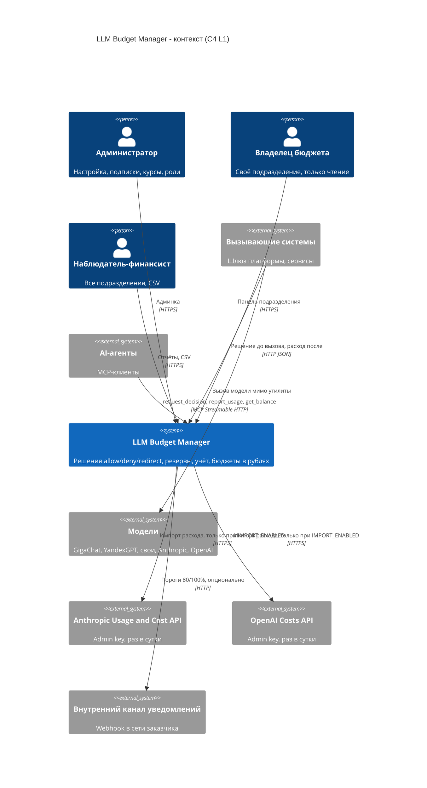
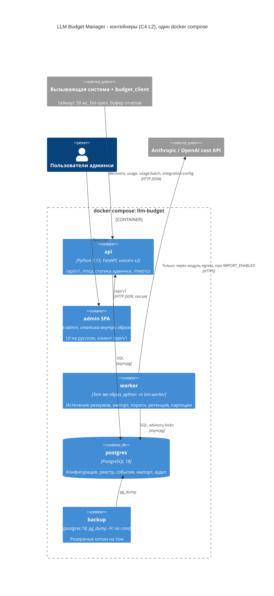

# 11. Архитектурное предложение (режим `classic`, без ML/AI): LLM Budget Manager v1

**Автор:** архитектор classic. **Дата:** 2026-10-13. **Входы:** `10_tech_spec.md`, `10_constitution.md`, `10_tech_brief_for_architects.md`, `10_tech_qa.md`, `06_ceo_verdict.md`, `02_certification.md`, `02_legal.md`, `07_po_q11.md`. Предложение второго архитектора не читалось.

---

## 1. Суть в 5 строк

1. **Что строим.** Модульный монолит: один образ на Python (FastAPI) с двумя процессами (`api` и `worker`), PostgreSQL как единственное хранилище и источник истины, статическая админка на react-admin. Поставка — `docker compose up` на одной машине. Очередей, Redis и ML нет.
2. **Ключевая идея.** Все деньги проходят через один глубокий модуль `budget`. В нём суточный реестр расхода по дате расхода, целые копейки и блокировка строки владельца бюджета (сотрудник, подразделение) на время решения. Поэтому перерасход из-за параллельных запросов равен нулю по построению. Поздний импорт сам попадает в прошлый период, а остаток по FR-026 считается одной функцией, которую используют API, MCP, админка, отчёты и уведомления.
3. **Почему это лучшее в режиме classic.** В спецификации нет ни одного требования, для которого нужен ML. Решение allow/deny/redirect — это детерминированная фильтрация и сортировка по цене (принцип VI прямо запрещает вероятностную логику). Самое простое надёжное решение: одна СУБД с транзакциями и чистые функции, которые закрываются табличными тестами.
4. **Стоимость MVP** [Гипотеза, расчёт в §11–12]: 17,1 чел.-нед. ≈ **3,95 чел.-мес. ≈ 1,90 млн ₽** для P1 + P2, оба коннектора, уведомления только в админке. MCP и внешний канал — «если останется время». Полный объём с MCP и webhook — 17,7 чел.-нед. ≈ 4,09 чел.-мес. ≈ 1,96 млн ₽: это выше рамки 4 чел.-мес. и ниже 2 млн ₽. Запаса нет.
5. **Срок:** ≈ 10 календарных недель командой из 2 backend, frontend (частично), DevOps (частично), QA (частично) и техлида. Перед этим — спайк на 3 дня вместо прототипа LiteLLM (§12.4).

---

## 2. Соответствие требованиям

| Требование | Как закрывается | Риск невыполнения |
|---|---|---|
| FR-001, FR-002 | `POST /api/v1/decisions`: строгая схема (Pydantic, `extra="forbid"`), единые коды `model_not_allowed`, `budget_exceeded`, `model_unknown`, `subject_unknown`; HTTP 403/429/422 по смыслу кода, тело одинаковое | Низкий |
| FR-003 | Чистая функция `select()` получает остатки всех применимых лимитов (личные и подразделения × день, неделя, месяц) и берёт минимальный. В ответе — какой лимит применён и дата сброса | Низкий |
| FR-004 | Кандидаты: разрешены субъекту ∩ тип `chat` ∩ возможности ⊇ требуемых ∩ `max_context ≥` требуемого ∩ (цена 0 **или** оценка ≤ остатка). Сортировка по (оценка, `tie_order`, id). Эмбеддинги отсекаются до поиска | Низкий |
| FR-005 | Режим политики подразделения — поле снимка конфигурации. В режимах `observe` и `warn` ответ «разрешить» с флагом `over_limit` и записью в журнал | Низкий; открытый вопрос Q2 (§16) |
| FR-006 | `GET /api/v1/integration-config` отдаёт режим fail-open или fail-closed и таймаут. Эталонный клиент `budget_client` (§4.9) кэширует их на диске | Средний: работает, только если вызывающие стороны встроят клиент (R-5) |
| FR-007, FR-010 | Резерв — строка `call_record` со статусом `open`, сумма прибавляется к `budget_lock.reserved_kop`. `worker` раз в минуту закрывает просроченные резервы по оценке с флагом `no_report` | Низкий |
| FR-008, FR-009 | `POST /api/v1/usage`: факт по снимку цены на момент решения, уникальность по `decision_id`. Повтор возвращает `duplicate`, сумма не меняется | Низкий |
| FR-011 | `POST /api/v1/usage:batch` (до 1 000 строк). Ключ идемпотентности для отчётов без решения — `(caller_id, report_id)`, где `report_id` — UUID, который генерирует клиент | Низкий |
| FR-012 | Загрузка CSV выгрузки групп AD: `dry_run`, сводка (добавлено, изменено, выведено, ошибки), строки с ошибками пропускаются. Если основная группа не отмечена — первая по порядку с предупреждением | Низкий |
| FR-013, FR-014 | Таблицы лимитов и политик. Модуль `periods` считает календарь по `Europe/Moscow` (zoneinfo), неделя начинается с понедельника | Низкий |
| FR-015 | `model` + `model_price` с историей (`valid_from`). Решение сохраняет id цены, по которому позже считается факт | Низкий |
| FR-016 | Ключи `bm_<prefix>_<secret>`: в БД хранятся префикс и SHA-256, ключ показывается один раз, отзыв мгновенный | Низкий |
| FR-017…FR-020 | Подписки и курсы — справочники. Амортизация считается на лету чистой функцией с накопительным округлением (§5.3). `POST /subscriptions:preview` показывает долю бюджета до сохранения | Низкий; открытый вопрос Q1 про пример 4.1 |
| FR-021…FR-025 | `worker`: коннекторы `AnthropicCostSource` и `OpenAICostSource` за флагом `IMPORT_ENABLED=false`. Upsert по `(provider, source, model, day)` с дельтой в реестр. Справочник источников с одним способом учёта. Повторы и уведомление после 2-й неудачи подряд | Средний: формат API провайдеров и суточные корзины в UTC (§5.4, R-4) |
| FR-026 | Одна функция `Budget.balance()`. Слагаемые раскладываются до строк `call_record`, `import_line` и `subscription` (drill-down в API) | Низкий |
| FR-027…FR-029 | Админка на русском (react-admin + свой файл переводов). Отчёты из реестра. Уведомления 80/100% — уникальный ключ «подразделение × период × порог», в админке; webhook — по возможности | Низкий; webhook первым уходит под урезание |
| FR-030, FR-031 | Локальные учётные записи (argon2id), три роли. Одна функция `authorize()` в сервисном слое. Журнал аудита пишется в той же транзакции, у роли приложения нет UPDATE и DELETE на нём | Низкий |
| FR-032 | Админка — SPA, которая говорит только с публичным `/api/v1`. Других серверных путей для UI нет | Низкий |
| FR-033 | MCP-сервер (официальный SDK `mcp`, Streamable HTTP) смонтирован в тот же ASGI-процесс на `/mcp`. Три инструмента вызывают те же методы `Budget` | Низкий; P3, первым уходит под урезание |
| FR-034, FR-035 | В схемах API нет свободных текстовых полей, лишние поля отклоняются (422). В событиях хранится суррогатный id сотрудника, наружу отдаётся псевдоним. Логин AD видит только администратор | Низкий |
| FR-036 | Месячные партиции `call_record`, worker удаляет партиции старше 12 мес. Агрегат `agg_daily` (подразделение × модель × день × источник, без сотрудников) хранится 36 мес. | Низкий |
| FR-037 | Один `docker compose up`, `.env.example`, сервис `backup` (pg_dump по расписанию), `make restore` и описание процедуры | Низкий |
| SC-001 | Горячий путь — одна транзакция Postgres из 3–4 запросов, конфигурация в памяти процесса. Проверка — vegeta 50 rps на эталонном стенде (§9.1) | **Средний: цифр нет до спайка** [Гипотеза] |
| SC-002 | Эталонный клиент: таймаут 50 мс, fail-open или fail-closed по закэшированной конфигурации, буфер отчётов на диске. Отказной тест в `make failover-test` | Низкий для утилиты, средний для покрытия |
| SC-003 | Ответ 200 на отчёт приходит только после COMMIT (`synchronous_commit=on`). Тест с `kill -9` api и postgres под нагрузкой | Низкий |
| SC-004 | Блокировки строк `budget_lock` в фиксированном порядке. Перерасход из-за гонок = 0, остаток риска — только «факт > оценки» (§9.2) | Низкий |
| SC-005 | Отчёт сверки: импорт и события Decision API по источнику за месяц, оба в сутках UTC | **Средний**: зависит от того, привязаны ли вызывающие системы к источнику (§5.4) |
| SC-006, SC-007 | Табличные тесты на чистых функциях `select()`, `amortize()`, `cost()` плюс приёмочные тесты на настоящем Postgres. Деньги — целые копейки и `Decimal` | Низкий |
| SC-008 | Импорт в 04:00 МСК, когда корзина суток D в UTC уже закрыта, затем повтор раз в час до 12:00 | Низкий при доступности провайдера |
| SC-009 | Готовые образы, миграции при старте, первый администратор из переменных окружения | Низкий |
| SC-010 | Матрица «роль × операция» генерируется из одной таблицы прав, тест проверяет все клетки | Низкий |
| SC-011 | Схема БД без текстовых полей для содержимого, `extra="forbid"`, тест на запрещённые поля и выборку логов | Низкий |
| SC-012 | Один экземпляр + `restart: unless-stopped` + fail-open. 99,5% в рабочее время для одной машины реалистично [Гипотеза] | Средний: одна машина — единая точка отказа, это смягчает fail-open |
| SC-013 | §11–12: 3,95 чел.-мес. с урезанием MCP и webhook, без запаса | **Высокий** (R-1) |
| SC-014 | Вне приёмки v1. Утилита даёт данные для сравнения (агрегаты по подразделениям до и после режима `enforce`) | Не зависит от архитектуры |

**Требования, невыполнимые без ML.** Таких нет. Две вещи не выполняются полностью ни с ML, ни без него, потому что это ограничения данных:
- **Сутки по МСК для импорта.** Cost API Anthropic и Costs API OpenAI отдают стоимость только суточными корзинами (`bucket_width=1d`) [Факт: [Anthropic](https://platform.claude.com/docs/en/build-with-claude/usage-cost-api), [OpenAI](https://developers.openai.com/api/reference/resources/organization/subresources/audit_logs/methods/get_costs)]. По примерам границы корзин в UTC [Вывод: в документации пример с `Z`, часовой пояс явно не указан]. Разложить сутки UTC на сутки МСК точно нельзя, поэтому принимаем соглашение «сутки UTC провайдера = дата расхода» (сдвиг 3 ч, §5.4).
- **Источник «ключ» у Anthropic.** `cost_report` группирует только по `workspace_id` и `description`, разбивки по API-ключу в нём нет [Факт, там же]. Для Anthropic источник — workspace, ключи нужно разнести по workspace. У OpenAI `group_by` поддерживает `project_id` и `api_key_id` [Факт, там же].

---

## 3. Контекст и контейнеры (C4 L1–L2)

### L1 — контекст



### L2 — контейнеры



Контейнеров четыре: `api`, `worker`, `postgres`, `backup`. Брокеров, кэшей, планировщиков и Prometheus-сервера в поставке нет (принцип VIII).

---

## 4. Компоненты и модули

Структура репозитория: `app/backend/bm/…` (Python-пакет), `app/frontend/` (react-admin), `app/client/budget_client/` (эталонный клиент), `deploy/` (compose, `.env.example`, backup), `tests/` (acceptance, load, failover, roles).

### 4.1. `budget` — ядро денег (самый глубокий модуль)

**Интерфейс** (всё, что знает вызывающий):
```python
class Budget:
    async def decide(self, cmd: DecideCmd, caller: Caller) -> Decision
    async def settle(self, reports: list[UsageReport], caller: Caller) -> list[Settlement]  # 1 или пакет
    async def balance(self, owner: OwnerRef, at: datetime | None = None) -> Balance       # FR-026, с разбивкой
    async def expire_reserves(self, now: datetime) -> int                                 # для worker
```
Инварианты: суммы — `int` копеек. `decide` и `settle` атомарны. После возврата из `settle` факт уже закоммичен. Решение детерминировано при одинаковых снимке конфигурации и реестре. Ошибки домена возвращаются как `Decision(outcome="deny", code=…)`, не исключениями.

**Что скрыто за швом:** разрешение субъекта, снимок конфигурации, блокировки, чтение реестра, амортизация подписок, выбор модели, резерв, пересчёт валют, флаги (`duplicate`, `no_report`, `no_decision`, `decision_not_followed`), запись в агрегат.

**Внутренние швы (для тестов модуля, не наружу):**
- `periods.bounds(kind, at) -> Period(start, end, resets_at)` — чистая функция, МСК.
- `money.cost(tokens, price, fx) -> int` — чистая функция, `Decimal`, ROUND_HALF_UP до копейки один раз на событие.
- `amortize(sub, period, today, fx) -> int` — чистая функция, накопительное округление (§5.3).
- `select(request, candidates, remaining) -> Outcome` — чистая функция, сердце сценария 1, табличные тесты на все пограничные случаи.
- `Clock` — инжектируется, чтобы тестировать переходы суток, недели и месяца.

Удаление этого модуля (deletion test) размазало бы правило FR-026 по API, MCP, отчётам и уведомлениям. Это и есть главный аргумент за его глубину.

### 4.2. `config` — снимок конфигурации

`snapshot() -> ConfigSnapshot` (неизменяемый: подразделения, сотрудники, назначения, лимиты, политики, каталог, цены, курсы, подписки, ключи) и `apply(change, actor) -> None` (запись + аудит + `config_version += 1` в одной транзакции). Каждый процесс держит снимок в памяти и в начале транзакции решения проверяет `config_version` одним запросом. Если версия изменилась, снимок перечитывается. Объём при 1 000 сотрудников и 30 моделях — единицы мегабайт [Вывод].

### 4.3. `org_import` — оргструктура из файла AD

`import_ad_csv(file, dry_run) -> ImportSummary`. Формат CSV (UTF-8): `login;display_name;group;is_primary`. Перевод между подразделениями закрывает старое назначение и открывает новое (`employee_assignment` с историей).

### 4.4. `provider_import` — импорт расхода

`run(provider, days: DateRange) -> RunResult`. Шов `CostSource.fetch(range) -> list[CostLine]` с двумя реальными адаптерами (Anthropic, OpenAI) и фейком на записанных ответах, то есть шов настоящий. Логика замены, статусов (`charged`, `reconcile`, `unallocated`), дельты в реестр и уведомлений — общая для обоих провайдеров.

### 4.5. `notify` — уведомления

`evaluate(now) -> list[Notification]` (worker, раз в минуту) и `deliver(n)`. Канал — шов с адаптерами `InApp` (таблица, обязателен) и `Webhook` (опционален, только адреса из частных диапазонов).

### 4.6. `access` — роли и аудит

`authorize(principal, action, scope) -> None | Forbidden`. Таблица прав — данные, из неё генерируется и проверка, и тест SC-010. Отказ пишется в аудит.

### 4.7. `reports` — отчёты

`spend(filter) -> rows`, `spend_csv(filter) -> stream`, `reconciliation(month) -> rows`. Только чтение реестра и агрегатов. В CSV нет полей сотрудников по построению: запрос строится от `agg_daily`.

### 4.8. Адаптеры входа

- `http` — роутеры FastAPI: валидация, аутентификация, маппинг кода в HTTP-статус. Логики нет.
- `mcp` — три инструмента официального SDK вызывают `Budget.decide/settle/balance`. Ключ передаётся в заголовке `X-Api-Key`, коды те же. Дублирования логики нет: это два тонких адаптера над одним интерфейсом.

### 4.9. `budget_client` — эталонная схема интеграции (FR-006, SC-002)

Python-пакет на 300–500 строк [Гипотеза] плюс описание протокола для других языков:
- `decide()` с таймаутом 50 мс. При таймауте или ошибке соединения берётся `fail_mode` из закэшированного `integration-config` (обновляется раз в 60 с и сохраняется на диск, поэтому переживает рестарт клиента). При `open` вызов модели разрешается, при `closed` клиент выбрасывает `policy_unavailable`.
- `report()` пишет в локальный журнал (SQLite, public domain) с fsync. Фоновый поток досылает журнал через `usage:batch` с экспоненциальной задержкой. Дублей нет благодаря `report_id` и `decision_id`.

### 4.10. `worker`

Цикл с задачами и Postgres advisory lock на каждую задачу: истечение резервов (1 мин), пороги (1 мин), импорт (04:00 МСК, повтор раз в час до успеха), проверка доли подписок (00:05 МСК), ретенция и партиции (ежедневно). Последние запуски хранятся в таблице `job_run`, которую видно в админке. Отдельный планировщик не нужен.

### 4.11. `egress` — единственный исходящий HTTP-клиент

Allowlist: `api.anthropic.com` и `api.openai.com` — только при `IMPORT_ENABLED=true`; хост `WEBHOOK_URL` — только если он резолвится в частный диапазон. Остальные модули не импортируют `httpx`, это проверяет import-linter в CI (§10).

---

## 5. Данные

### 5.1. Сущности и таблицы (PostgreSQL)

| Таблица | Ключевые поля | Примечание |
|---|---|---|
| `department` | id, ad_group, name, policy_mode (`observe`/`warn`/`enforce`), fail_mode (`open`/`closed`), subs_warn_pct | |
| `employee` | id (UUID), pseudonym (уникальный, случайный), ad_login, display_name, status | `ad_login` и `display_name` отдаются только администратору |
| `employee_assignment` | employee_id, department_id, valid_from, valid_to | История переводов |
| `caller_system` | id, name, key_prefix, key_sha256, department_id (для служебных), provider_source_id (для сверки), status, revoked_at | |
| `limit_def` | owner_type, owner_id, period (`day`/`week`/`month`), amount_kop | PK по (owner_type, owner_id, period) |
| `dept_model_allow` | department_id, model_id | |
| `model` | id (как передаёт вызывающий), provider, kind, supports_tools, supports_json, max_context, default_in/out_tokens, tie_order, active | |
| `model_price` | id, model_id, valid_from, price_in_1k, price_out_1k, price_cached_1k, currency | NUMERIC(18,6), история не меняется |
| `fx_rate` | month, usd_rub NUMERIC(12,4), entered_by, entered_at | |
| `budget_lock` | owner_type, owner_id, reserved_kop | Строка-замок и счётчик открытых резервов |
| `call_record` (партиции по месяцам) | id (UUIDv7), caller_id, report_id, employee_id, department_id, requested_model, final_model, outcome, code, price_id, fx, est_kop, fact_kop, tokens_in/out/cached, call_status, flags[], status (`open`/`settled`/`expired`), expense_date (МСК), created_at, settled_at | Решение и факт в одной строке. Отчёт без решения — строка с `outcome='none'`. Уникальность: `id` и `(caller_id, report_id)` |
| `ledger_daily` | owner_type, owner_id, day, source (`token`/`import`), amount_kop | Суточный реестр по дате расхода. Запись в той же транзакции, что и факт |
| `subscription` | id, provider, plan, seat_price, currency, seats, start_date, end_date, assignee_type, assignee_id, deleted_at | Амортизация не материализуется, считается функцией |
| `provider_source` | id, provider, kind (`workspace`/`project`/`api_key`), ref, department_id, mode (`import`/`decision_api`) | Ровно один способ учёта на источник (UNIQUE provider + ref) |
| `import_line` | provider, source_ref, model, day, amount_orig, currency, fx, amount_kop, status, version, fetched_at | PK по (provider, source_ref, model, day) → замена, а не добавление |
| `import_run` | provider, started_at, finished_at, ok, error_class, days | Отставание и счётчик неудач |
| `notification` | department_id, period_kind, period_start, kind (`80`/`100`/`subs`), recipients, channel, delivery_status | UNIQUE → одно уведомление на порог за период |
| `agg_daily` | day, department_id, model_id, source, amount_kop, tokens | Без сотрудников, 36 мес. |
| `admin_user`, `session` | login, argon2 hash, role, department_id | |
| `audit_log` | at, actor, action, object, before jsonb, after jsonb | Только INSERT для роли приложения |
| `config_version`, `job_run` | | Служебные |

### 5.2. Остаток (FR-026) — как считается

Для владельца O и периода P (сегодня по МСК):

```
remaining(O, P) = limit(O, P)
                − Σ ledger_daily(O, d ∈ [P.start, today], source ∈ {token, import})
                − budget_lock(O).reserved_kop
                − Σ amortize(sub, P, today) по подпискам O (для подразделения — также подписки его сотрудников)
```

- Факт сотрудника пишется в две строки `ledger_daily`: сотрудника и подразделения. Импорт пишется только в строку подразделения (ограничение спецификации).
- Импорт со статусом `reconcile` или `unallocated` в реестр не попадает. Это и есть защита от двойного учёта (принцип VI).
- Датой расхода факта считается дата решения по МСК. Для отчёта без решения — `occurred_at` от клиента, но не раньше чем 7 дней назад [Гипотеза]. Так расход, буферизованный во время сбоя, ложится на правильные сутки.
- Прослеживаемость: `balance(…, explain=true)` раскладывает каждое слагаемое до строк `call_record`, `import_line` и `subscription`.

### 5.3. Точность до копейки (SC-007)

- Хранение: суммы `BIGINT` в копейках, цены и курсы `NUMERIC`. Вычисления в Python через `Decimal`, без `float`.
- Событие: `fact_kop = round_half_up((in·p_in + out·p_out + cached·p_cached)/1000 · fx)`, одно округление на событие.
- Подписка: месячная стоимость в копейках `M = round_half_up(seats · seat_price · fx_месяца)`. Накопительная амортизация за k оплачиваемых дней месяца — `cum(k) = round_half_up(M · k / days_in_month)`. Расход за любой период внутри месяца равен `cum(конец) − cum(начало − 1)`. Неделю, которая пересекает границу месяца, считаем по частям. Сумма за месяц равна `M` ровно.
- **Расхождение с примером спецификации (вопрос Q1).** В сценарии 4.1 указано «241,94 ₽ за сегодня». При накопительном правиле доля 10-го числа = 2 419,35 − 2 177,42 = **241,93 ₽**. Если же округлять каждый день отдельно (241,94 × 31 = 7 500,14 ₽), месяц не сходится с ценой подписки на 14 копеек, а это нарушает «точно, один раз» и SC-007. Предлагаю исправить пример на 241,93 и зафиксировать правило в документации администратора.

### 5.4. Импорт: задержка, уточнения, поздние данные, UTC

- Запуск в 04:00 МСК. Окно загрузки — последние 7 суток UTC [Гипотеза: как долго провайдер уточняет суммы, не документировано]. Upsert по `(provider, source, model, day)`. Если сумма изменилась, `version += 1`, а в `ledger_daily` пишется дельта (новое − старое) в той же транзакции. Повторная загрузка без изменений ничего не меняет (FR-024).
- **Соглашение о сутках.** Корзина провайдера `[D 00:00Z, D+1 00:00Z)` → дата расхода D. Это сдвиг на 3 часа относительно МСК, он описывается в документации администратора. Сверка (SC-005) для честного сравнения агрегирует события Decision API тоже по суткам UTC.
- Поздние данные за закрытый период попадают в `ledger_daily` своего дня. Остаток текущего периода их не видит, потому что вне диапазона дат, а отчёт прошлого периода показывает перерасход (сценарий 5.7). Отдельной логики для этого нет — так устроен реестр.
- Новые решения учитывают импорт сразу после коммита загрузки. Выданные ранее решения не отзываются.
- Для сверки SC-005 у вызывающей системы задаётся `provider_source_id` (каким ключом, проектом или workspace она ходит к провайдеру). Без этой привязки сверка возможна только на уровне подразделения.
- Валюта: Anthropic отдаёт USD в центах строкой-десятичной [Факт]. Пересчёт в рубли — по курсу месяца даты расхода, исходные валюта, сумма и курс сохраняются (FR-019).

### 5.5. Жизненный цикл и объёмы

- `call_record`: месячные партиции, удаление партиций старше 12 мес. одной командой `DROP` без долгого `DELETE`. Строки `ledger_daily` сотрудников тоже живут 12 мес. `agg_daily` хранится 36 мес.
- Объём [Вывод, формула]: строка `call_record` ≈ 250–350 байт с индексами [Гипотеза]. При пиковых 50 rps, если держать их весь рабочий день (8 ч × 21 день), получается ≈ 30 млн строк в месяц ≈ 9–11 ГБ в месяц, то есть до ≈ 130 ГБ за 12 мес. Это верхняя оценка: 50 rps — пик, средняя нагрузка пилота неизвестна. Диск эталонного стенда — от 200 ГБ SSD.
- Не храним: тексты запросов и ответов, ключи провайдеров (только в окружении), открытые ключи вызывающих систем (только SHA-256).

---

## 6. Контракт API (набросок)

Все пути начинаются с `/api/v1`. Аутентификация: вызывающие системы передают `X-Api-Key`, админка — сессионную cookie (HttpOnly, SameSite=Strict) и заголовок `X-CSRF`.

| Метод, путь | Вход | Выход | Ошибки |
|---|---|---|---|
| `POST /decisions` | `subject {type: employee\|service, login?}`, `model`, `kind: chat\|embedding`, `est_input_tokens?`, `max_output_tokens?`, `needs {tools, json, context_tokens}` | `200`: `{decision_id, outcome: allow\|redirect, model, requested_model, reserve_rub, reason?, over_limit, mode, expires_at}` | `403 model_not_allowed`, `429 budget_exceeded {applied_limit {owner, period, remaining_rub, resets_at_msk}}`, `422 model_unknown \| subject_unknown \| validation`, `401` |
| `POST /usage` | `decision_id?` или (`subject`, `model`, `report_id`, `occurred_at`); `tokens {in, out, cached}`, `call_status`, `actual_model?` | `200 {status: charged\|duplicate, amount_rub, flags[]}` | `401`, `404 decision_not_found`, `422` |
| `POST /usage:batch` | `items[≤1000]` | `200 {results[]}` (по каждой строке) | `401`, `413` |
| `GET /balance` | `subject=` или `department=`, `explain?` | `{limits: [{owner, period, limit_rub, spent: {token, import, subscriptions}, reserved_rub, remaining_rub, resets_at_msk}]}` | `401`, `403`, `404` |
| `GET /integration-config` | — | `{timeout_ms: 50, fail_mode_by_department, refresh_s}` | `401` |
| `POST /org-import` | multipart CSV, `dry_run` | `ImportSummary` | `422` |
| CRUD `/departments`, `/employees`, `/limits`, `/models`, `/models/{id}/prices`, `/fx-rates`, `/subscriptions`, `/provider-sources`, `/callers`, `/admin-users` | | | `403`, `409`, `422` |
| `POST /subscriptions:preview` | подписка | `{share_pct_by_period}` | |
| `POST /callers` | имя, подразделение? | ключ один раз | |
| `GET /imports/runs`, `POST /imports:run` | провайдер, сутки | статус, отставание | `409 import_disabled` |
| `GET /reports/spend`, `GET /reports/spend.csv`, `GET /reports/reconciliation` | период, фильтры | строки или CSV | `403` |
| `GET /notifications`, `GET /audit` | фильтры | списки | `403` |
| `GET /pseudonyms/{p}` | — | логин (только для администратора) | `403` (+ запись в аудит) |
| `POST /auth/login`, `POST /auth/logout` | | | `401`, `429` |
| `/healthz`, `/readyz`, `/metrics` | | | |

**MCP** (`/mcp`, Streamable HTTP): `request_decision` (параметры как у `POST /decisions`), `report_usage` (как у `POST /usage`), `get_balance` (как у `GET /balance`). Ответ — тот же JSON. Отказ — `isError=false`, `outcome=deny` и тот же `code`: отказ — это результат решения, а не ошибка инструмента. Без ключа возвращается ошибка `unauthorized`.

---

## 7. Стек

| Слой | Выбор | Лицензия | Почему | Проверка |
|---|---|---|---|---|
| Язык | Python 3.13 | PSF-2.0 | Быстрее всего разработать. Для 50 rps на I/O-bound пути хватает асинхронного стека [Гипотеза, проверяется спайком] | — |
| HTTP | FastAPI 0.143 + uvicorn + Pydantic v2 | MIT / BSD-3 / MIT | Схемы и OpenAPI из кода, `extra="forbid"` | [Факт] FastAPI 0.143.0 от 08.10.2026, MIT ([PyPI](https://pypi.org/project/fastapi/)); лицензии uvicorn и Pydantic — [Вывод], подтвердить SCA |
| Драйвер БД | asyncpg 0.32 | Apache-2.0 | Быстрый, разрешительная лицензия. **psycopg 3 не берём: LGPL-3** — её нет в белом списке | [Факт] asyncpg 0.32.0 от 06.10.2026, Apache-2.0 ([PyPI](https://pypi.org/project/asyncpg/)); psycopg3 — LGPL-3 ([Debian copyright](https://metadata.ftp-master.debian.org/changelogs/main/p/psycopg3/stable_copyright)) |
| SQL | Ручной SQL + свой раннер миграций на чистом SQL (~100 строк) | — | Денежные запросы явные и ревьюируемые, без лишней зависимости | ADR-0002 |
| БД | PostgreSQL 18 | PostgreSQL License | Транзакции, блокировки строк, партиции. Совместима с Postgres Pro для следующего этапа на российских ОС | [Факт] 18.6 актуальна, EOL 14.11.2030 ([postgresql.org](https://www.postgresql.org/support/versioning)) |
| MCP | `mcp` (официальный Python SDK) 2.x | MIT | Streamable HTTP, тот же процесс | [Факт] 2.3.0 от 02.10.2026, MIT, Streamable HTTP ([PyPI](https://pypi.org/project/mcp/)). Монтирование в ASGI на странице PyPI не описано — проверить в спайке |
| HTTP-клиент (импорт, webhook) | httpx | BSD-3 [Вывод] | Таймауты, ретраи | SCA |
| Пароли | argon2-cffi | MIT [Вывод] | argon2id | SCA |
| Метрики | prometheus-client | Apache-2.0 [Вывод] | Только `/metrics`, без сервера в поставке | SCA |
| Время | zoneinfo + tzdata | Apache-2.0 [Вывод] | `Europe/Moscow` не зависит от ОС | SCA |
| Админка | react-admin 5 (только MIT-ядро, **без пакетов Enterprise Edition**), React, MUI core | MIT | CRUD-списки, формы и фильтры из коробки для ~12 сущностей — главная экономия frontend | [Факт] react-admin MIT, последняя 5.15.4; EE (`ra-rbac`, `ra-audit-log` и др.) платная ([marmelab](https://marmelab.com/react-admin/Readme.html)) |
| Перевод | Свой файл `ru.ts` на основе ra-language-russian | MIT | Пакет не обновлялся с 2021 г., ключи v5 могут не совпадать | [Факт] MIT, обновлён 28.03.2021 ([skypack](https://www.skypack.dev/view/ra-language-russian)) |
| Шрифты | Системный стек шрифтов, без Google Fonts и `@fontsource` | — | Принцип IV: без CDN; OFL не нужно согласовывать с юристом | — |
| Сборка фронта | Vite (только сборка, в рантайме Node нет) | MIT [Вывод] | | SCA |
| Нагрузка | vegeta | MIT | Постоянный rate, p95 и p99 в отчёте. Не k6 (AGPL) | [Факт] MIT, p95/p99 ([GitHub](https://github.com/tsenart/vegeta)) |
| Качество и SDL | pytest, import-linter, CycloneDX SBOM, pip-audit, npm audit, Trivy, проверка лицензий | Разрешительные [Вывод] | Принцип V, ГОСТ Р 56939 | Лицензии инструментов подтвердить SCA (в поставку не входят) |
| Контейнеры | Docker Engine + compose v2, базовые образы `python:3.13-slim`, `postgres:18` | — | v1 локально. Для реестра — зеркало образов в РФ (`02_certification.md` §5) | [Вывод] |

**Что не берём:** LiteLLM (модели вызываются мимо утилиты, D1), Redis, Kafka и RabbitMQ, Celery, ORM, OPA, Prometheus и Grafana в поставке, k6 (AGPL), psycopg (LGPL).

---

## 8. Только для режима `ai`

Неприменимо. ML не используется ни в критическом пути, ни вне его. Там, где архитектор `ai` мог бы предложить ML, есть детерминированные замены: оценка токенов при её отсутствии — значения по умолчанию из каталога (`default_in/out_tokens`), совместимость моделей — явные флаги возможностей в каталоге, которые ведёт администратор.

---

## 9. Нефункциональные требования

### 9.1. Производительность (SC-001)

**Эталонный стенд** (фиксирую): 4 vCPU x86-64, 8 ГБ RAM, NVMe SSD от 200 ГБ, Linux, Docker Engine + compose v2. `api` (2 воркера uvicorn), `postgres` (`shared_buffers=1GB`) и генератор нагрузки на одном хосте. Обоснование: это типичный небольшой сервер или рабочий ноутбук для пилота «локально в Docker». 50 rps — нагрузка, при которой такой стенд не должен быть узким местом [Гипотеза, проверяется спайком].

**Горячий путь `decide`:**
1. Проверка ключа: SHA-256 и поиск в снимке, без запроса к БД.
2. В транзакции:
   - `SELECT version FROM config_version`; при смене версии снимок перечитывается.
   - `SELECT … FROM budget_lock WHERE (owner) IN (dept, emp) ORDER BY owner_type, owner_id FOR UPDATE`.
   - Один запрос `SUM … FILTER` по `ledger_daily` за `[min(week_start, month_start), today]` для двух владельцев: не больше 37 дней × 2 владельца × 2 источника строк по первичному ключу.
   - Подписки — из снимка, `select()` — в памяти.
   - `INSERT call_record` + `UPDATE budget_lock.reserved_kop`.
3. COMMIT.

Итого 4 обращения к БД. Цифр задержки до замера не привожу. Критерий спайка: p95 ≤ 10 мс внутри и ≤ 20 мс у клиента на 50 rps в течение 10 мин.

**План Б, если спайк не уложится** [Вывод]: (а) держать в `budget_lock` текущие суммы дня, недели и месяца и сбрасывать их на границах — тогда запрос `SUM` не нужен; (б) увеличить число воркеров; (в) prepared statements. Redis не нужен ни в одном из вариантов.

### 9.2. Параллельность и перерасход (SC-004)

- Решение берёт `FOR UPDATE` на строки `budget_lock` подразделения и сотрудника в фиксированном порядке, поэтому дедлоков нет. Остаток читается после получения блокировки и уже включает резервы всех закоммиченных решений. Два решения не могут потратить один и тот же остаток.
- **Гарантия:** перерасход из-за параллельности = 0. Остаточный перерасход возникает, только если факт больше оценки (R-6), из-за fail-open (решения не было) и из-за позднего импорта. Все три видны в отчёте флагами.
- **Проверка:** 3 экземпляра клиента × 50 одновременных запросов на границе лимита. Утверждения: Σ резервов ≤ остатка (строго); при факте = оценке Σ фактов ≤ лимита; при факте = оценка × 1,1 перерасход ≤ 2% лимита (если нет — тест показывает вклад R-6, а не гонки).
- Конкуренция за строку подразделения: при 50 rps в одном подразделении блокировка держится на время 2–3 запросов [Гипотеза], очередь не накапливается. Это измеряется в спайке.

### 9.3. Надёжность

- SC-003: ответ на отчёт — только после COMMIT, `synchronous_commit=on`, fsync включён. Тест: `kill -9` контейнеров api и postgres под нагрузкой, затем сверка множества подтверждённых `report_id` с БД.
- SC-002: утилита — не единая точка отказа для AI благодаря fail-open у клиента. `restart: unless-stopped`, healthcheck в compose.
- Импорт изолирован в `worker`. Падение или зависание импорта не трогает `api` (принцип III).
- Резервные копии: `pg_dump -Fc` раз в сутки, хранятся 14 копий [Гипотеза] на отдельном томе. `make restore` и тест восстановления входят в QA. RPO — до 24 ч [Гипотеза]. Если нужно меньше — WAL-архив, но это вне v1.

### 9.4. Наблюдаемость

- Логи JSON в stdout: request_id, caller, код решения, длительность. Полей содержимого нет, псевдонимы вместо логинов, ключи вырезаются фильтром.
- `/metrics`: гистограмма длительности `decide`, счётчики исходов и кодов, открытые резервы, отставание импорта, неудачи задач worker.
- В админке на странице «Состояние» — последний успешный импорт, отставание, `job_run`.

### 9.5. Масштабирование

В v1 не требуется (принцип VIII). Следующий этап (Kubernetes, российские ОС) возможен без переделки: процессы без состояния, состояние только в Postgres, конфигурация из окружения.

---

## 10. Безопасность и регуляторика

- **Аутентификация.** Вызывающие системы — отзываемые ключи с префиксом и SHA-256: секрет высокоэнтропийный, медленный хеш не нужен [Вывод]. Админка — логин и пароль (argon2id), блокировка после N неудач, сессии в БД. Первый администратор создаётся из `ADMIN_INITIAL_PASSWORD`, при первом входе пароль нужно сменить. IdP/OIDC — P3, вне базового объёма.
- **Авторизация.** `authorize()` в сервисном слое, а не в UI. Все запросы владельца бюджета фильтруются по его `department_id` на уровне SQL. Матричный тест SC-010.
- **Секреты (принцип II).**
  - `ANTHROPIC_ADMIN_KEY` и `OPENAI_ADMIN_KEY` задаются только через окружение или Docker secrets (`*_FILE`) и читаются только в `worker`.
  - В БД их нет, значит, нет и в резервных копиях.
  - Фильтр логов маскирует значения, совпадающие с секретами.
  - Ответ API на настройки импорта — только `configured: true/false`.
- **Исходящий интернет (принцип IV).**
  - (1) Все исходящие HTTP-вызовы идут только через модуль `egress` с allowlist. Правило import-linter запрещает `httpx`, `urllib` и `socket` в остальных пакетах.
  - (2) При `IMPORT_ENABLED=false` коннекторы не создаются.
  - (3) Фронтенд без CDN и внешних шрифтов. Python, Node и Postgres без телеметрии: в образе задаются переменные отключения телеметрии зависимостей, если они есть.
  - (4) **Тест:** стек поднимается с флагом `false`, прогоняются все приёмочные тесты, на хосте в цепочке `DOCKER-USER` стоит правило-счётчик на трафик из подсети compose в нечастные адреса. Ожидается 0 пакетов. Дополнительно в pytest подменяется `socket.connect`: любое соединение не к Postgres роняет тест.
  - Сеть compose намеренно не `internal: true`: нужны опубликованный порт для вызывающих систем и доступ к webhook во внутренней сети. Поэтому гарантия держится на коде и тесте, а не на сети Docker [Вывод; поведение `internal` — [docs.docker.com](https://docs.docker.com/reference/compose-file/networks/)].
- **Шифрование.** v1 — HTTP на localhost или в доверенном сегменте. Для сети заказчика TLS (в том числе ГОСТ-TLS) терминируется на его прокси (`02_certification.md`, C). Собственной криптографии нет. Резервные копии содержат таблицу соответствия псевдонимов (ПДн), поэтому том должен лежать на зашифрованном диске заказчика — это пишется в документации.
- **152-ФЗ и ТК РФ.** Хранятся только метаданные, сотрудник представлен суррогатным id и псевдонимом, соответствие видит только администратор, ретенция 12 мес. (FR-034…FR-036). Утилита не включает режим `enforce` по умолчанию: новое подразделение создаётся в режиме `observe`. Это помогает соблюсти условие о локальном акте (ст. 86–88 ТК РФ) [Вывод]. Импорт от провайдеров содержит только суммы по workspace и проекту. Юристу нужно подтвердить, что это не трансграничная передача ПДн (D5).
- **Лицензии и SDL (принцип V, ГОСТ Р 56939).** Белый список. Проверка лицензий Python и npm в CI. CycloneDX SBOM. pip-audit, npm audit и Trivy. Gate: критические уязвимости или запрещённые лицензии роняют сборку. Пакеты `@react-admin/ra-*` (EE) запрещены правилом в проверке лицензий. Весь код наш (договоры отчуждения — гейт G0 сертификации), чужого ядра нет — это совпадает с вариантом 2 `02_certification.md`.

---

## 11. Стоимость владения (3 года)

Ставка 0,48 млн ₽/чел.-мес. (`06_ceo_verdict.md`), 4,33 нед./мес. Все суммы — [Гипотеза].

| Статья | Логика | Сумма |
|---|---|---|
| Разработка v1, вариант C (рекомендуемый объём) | 17,1 чел.-нед. (§12) / 4,33 = 3,95 чел.-мес. × 0,48 | **1,90 млн ₽** |
| Разработка v1, вариант A (полный, с MCP и webhook) | 17,7 / 4,33 = 4,09 чел.-мес. × 0,48 | 1,96 млн ₽ |
| Спайк Г1 (3 дня архитектора) | Внутри бюджета P0, не v1 (`06_ceo_verdict.md` §4) | 0 в v1 |
| Сопровождение | 0,25 FTE × 0,48 = 0,12 млн ₽/мес. (допущение движка CEO) × 33 мес. после релиза | 3,96 млн ₽ |
| Инфраструктура | Существующий сервер пилота (4 vCPU, 8 ГБ, 200 ГБ SSD). Аренду отдельной ВМ не оцениваю: цены нет | 0 [Гипотеза] |
| Лицензии | Только open source | 0 |
| Модели и GPU | Не используются | 0 |
| API провайдеров для импорта | Отдельной платы за Admin API в документации не видел | 0 [Гипотеза, проверить] |
| SDL-инструменты | SDL платформы уже есть (Q2 CEO) | 0 добавочно [Гипотеза] |
| **Итого за 3 года** | | **≈ 5,9 млн ₽** (C) / ≈ 5,9 (A) |

Совпадает с допущением D2 спецификации (разово ≤ 2,0 млн ₽ + 0,25 FTE). Пересчёт NPV — задача финансиста в движке, не моя.

---

## 12. План MVP

### 12.1. Трудоёмкость по работам (чел.-недели) [Гипотеза]

| # | Работа | Роль | чел.-нед. |
|---|---|---|---|
| 1 | Схема, миграции, `periods`, `money`, реестр и `balance` (FR-013, 014, 026) | BE1 | 1,5 |
| 2 | `decide`: снимок, блокировки, `select()`, резервы, режимы, коды (FR-001…005, 007) | BE1 | 1,5 |
| 3 | `settle`: отчёты, идемпотентность, пакет, истечение резервов, флаги (FR-008…011) | BE1 | 1,0 |
| 4 | Импорт: общая часть, справочник источников, сверка, отставание, повторы (FR-021…025) | BE1 | 0,8 |
| 5 | Коннектор Anthropic | BE1 | 0,5 |
| 6 | Коннектор OpenAI | BE1 | 0,5 |
| 7 | MCP-инструменты (FR-033) | BE1 | 0,4 |
| 8 | Конфигурация: импорт CSV AD, каталог и цены, лимиты, политики, ключи (FR-012, 015, 016) | BE2 | 1,5 |
| 9 | Подписки, курсы, амортизация, доля и предупреждения (FR-017…020) | BE2 | 1,0 |
| 10 | Уведомления: в админке 0,3 + webhook 0,2 (FR-029) | BE2 | 0,5 |
| 11 | Вход, роли, аудит, псевдонимы, отчёты, CSV (FR-027, 028, 030, 031) | BE2 | 1,2 |
| 12 | `budget_client` + стенд отказного теста (FR-006, SC-002) | BE2 | 0,8 |
| 13 | Админка на react-admin: CRUD, панель подразделения, импорт, подписки с предпросмотром, отчёты, состояние | FE | 2,5 |
| 14 | Compose, образы, backup и restore, `make check` (SBOM, SCA, лицензии), тест исходящих соединений | DevOps | 1,0 |
| 15 | Нагрузочный, отказной, kill-тест, матрица ролей, отсутствие содержимого, восстановление | QA | 1,5 |
| 16 | Документация администратора и интеграции (RU) | Техлид | 0,5 |
| 17 | Техлид: ревью, контроль бюджета, приёмка | Техлид | 1,0 |
| | **Итого A (полный)** | | **17,7** ≈ 4,09 чел.-мес. ≈ 1,96 млн ₽ |

Приёмочные тесты сценариев P1 пишутся первыми в рамках работ 1–3 и 8 (принцип VII): они уже включены в оценки, отдельно не считаются.

### 12.2. Урезание в порядке принципа VIII

| Вариант | Что убираем | чел.-нед. | чел.-мес. | млн ₽ | P1 цел? |
|---|---|---|---|---|---|
| A | — | 17,7 | 4,09 | 1,96 | да |
| B | MCP (IdP и так не в оценке, P3) | 17,3 | 3,99 | 1,92 | да |
| **C (рекомендую как обязательство)** | + внешний канал уведомлений | **17,1** | **3,95** | **1,90** | да |
| D | + коннектор OpenAI (импорт только Anthropic; расход OpenAI учитывается через Decision API) | 16,6 | 3,83 | 1,84 | да |

В объём C входят все P1 и P2, оба коннектора, уведомления в админке. MCP и webhook делаются, только если на контрольной точке недели 5 факт идёт не хуже плана. Если прогноз на этой точке больше 4 чел.-мес. даже для D — по SC-013 работа останавливается и решение принимает заказчик. Следующим кандидатом на урезание (вне порядка конституции, нужно решение) была бы админка: только CRUD и отчёты, без страниц предпросмотра и состояния, −0,5 чел.-нед. [Гипотеза].

### 12.3. Календарь (≈ 10 недель) и критический путь

| Неделя | BE1 | BE2 | FE | DevOps / QA |
|---|---|---|---|---|
| 1 | Схема, `periods`, `money`, красные приёмочные тесты сценариев 1–2 | Импорт CSV AD, каталог | — | Compose, `make check` |
| 2 | Реестр, `balance` | Лимиты, политики, ключи | — | Тест исходящих соединений |
| 3 | `decide`, `select()` | Подписки, курсы | — | — |
| 4 | `settle`, истечение резервов | `budget_client` | Каркас react-admin, вход | Нагрузочный и параллельный тест № 1 |
| 5 | Импорт: общая часть. **Контрольная точка: факт против плана, решение об урезании** | Отказной стенд | CRUD | — |
| 6 | Anthropic | Вход, роли, аудит | Подписки, предпросмотр | — |
| 7 | OpenAI, сверка | Отчёты, CSV, уведомления | Панель, отчёты | QA: матрица ролей |
| 8 | (MCP) | (webhook) | Импорт, состояние | QA: отказной и kill-тест |
| 9 | Исправления | Исправления | Перевод, правки | QA: нагрузка финальная, восстановление, SBOM |
| 10 | Релизный прогон, документация | | | Гейты релиза |

**Критический путь:** схема → реестр и `balance` → `decide` → `settle` → нагрузочный и параллельный тест (нед. 4) → импорт → QA (отказ, kill, нагрузка) → релиз. Узкое место — BE1 (6,2 чел.-нед. последовательно).

### 12.4. Спайк вместо прототипа LiteLLM (ответ на D3)

≤ 3 дня архитектора, внутри бюджета P0:
- **День 1.** Каркас `api` + Postgres 18 со схемой `budget_lock`, `ledger_daily`, `call_record`, `POST /decisions` с блокировками. vegeta 50 rps × 10 мин на эталонном стенде, серверная гистограмма. Параллельный тест: 3 клиента × 50 запросов на границе.
- **День 2.** Тестовые Admin-ключи Anthropic и OpenAI: `cost_report` и `/organization/costs` за 7 суток. Записать ответы в фикстуры, проверить UTC-границы корзин, поля сумм и валюты, пагинацию, поведение при повторной загрузке. Монтирование MCP SDK в ASGI.
- **День 3.** Отчёт.

**Критерии «дальше»:** p95 решения ≤ 10 мс внутри и ≤ 20 мс у клиента, p99 ≤ 25 мс; Σ резервов ≤ лимита; оба импорта загружены и сопоставлены. **Стоп или пересмотр:** p95 > 20 мс у клиента даже с планом Б (§9.1), либо Cost API недоступен из контура заказчика (R-4 → коннекторы вне v1).

---

## 13. Риски

| # | Риск | Вероятность | Влияние | Мера |
|---|---|---|---|---|
| A1 | Трудоёмкость больше 4 чел.-мес. (R-1): запаса в оценке нет | Высокая | Высокое | Обязательство — объём C, контрольная точка на нед. 5, порядок урезания §12.2, react-admin вместо самописного UI |
| A2 | Python и Postgres не дают p95 ≤ 10 мс | Низкая–средняя [Гипотеза] | Высокое (Г2) | Спайк до старта; план Б §9.1 без новых компонентов |
| A3 | Формат или поведение Cost API меняется, суточные корзины в UTC, уточнения после 7 дней | Средняя | Среднее | Коннекторы изолированы, фикстуры записанных ответов в тестах, соглашение UTC в документации, окно перезагрузки настраивается |
| A4 | Вызывающие стороны не встраивают клиент или игнорируют отказы (R-5) | Высокая | Высокое для Г2, не для утилиты | `budget_client` готов к встраиванию, флаг `decision_not_followed`, сверка с импортом, рекомендация закрыть прямой доступ к провайдерам сетью |
| A5 | Спор о копейках: пример 4.1 против накопительного правила | Средняя | Низкое | Q1 решить до старта, правило в документации, табличный тест |
| A6 | Устаревший русский перевод react-admin, тяжёлый MUI | Средняя | Низкое | Свой `ru.ts` (~200 ключей) [Гипотеза], сборка без CDN |
| A7 | Тест «0 исходящих соединений» сложно сделать надёжно на хосте пользователя | Средняя | Среднее (принцип IV) | Два уровня: import-linter + подмена `socket` в pytest (переносимо) и счётчик `DOCKER-USER` на стенде QA (обязателен для релиза) |
| A8 | Рост данных при длительных 50 rps (до ≈ 130 ГБ за год) | Низкая на пилоте | Среднее | Партиции, удаление через `DROP`, диск ≥ 200 ГБ, метрика размера БД |
| A9 | Одна машина — единая точка отказа (SC-012) | Средняя | Низкое для AI (fail-open), среднее для учёта | Буфер отчётов у клиента, ежедневный бэкап, тест восстановления |
| A10 | Неясная семантика: режим `observe` при неразрешённой модели (Q2), дата факта (Q5) | Средняя | Низкое | Вопросы §16 главному архитектору до `12_openapi.yaml` |

---

## 14. Отвергнутые альтернативы

| Альтернатива | Почему нет |
|---|---|
| Бюджеты LiteLLM (прокси) | Работают только для трафика через прокси, а заказчик вызывает модели мимо утилиты (D1). Нужный функционал частично в `enterprise/` (`07_po_q11.md`), сертификация рекомендует своё ядро |
| Redis для счётчиков (Lua-скрипты) | Быстрее, но это второе хранилище: двойная запись, восстановление после сбоя, сверка с Postgres ради SC-003 и SC-007. При 50 rps не нужен |
| Event sourcing, Kafka, RabbitMQ, Celery | Сложность без выгоды на одной машине; принцип VIII |
| Go или Java для горячего пути | Запас производительности, но медленнее разработка. Нужен только если спайк провалится и план Б не поможет |
| SQLite вместо Postgres | Проще, но один писатель на файл. Хуже параллельность двух процессов и бэкапы на горячую. Нет пути к Postgres Pro на российских ОС |
| OPA или движок правил для решений | Правила FR-003/004 — 30–50 строк чистой функции [Гипотеза]. Rego и ещё один контейнер не окупаются |
| Server-side шаблоны (Jinja + HTMX) для админки | Легче по зависимостям, но CRUD для ~12 сущностей придётся писать вручную, а FR-032 (админка — клиент API) выполняется хуже. react-admin даёт CRUD бесплатно |
| Материализовать амортизацию подписок в реестр | Нужна задача пересчёта при каждой правке подписки или курса. Функция на лету проще и точна |
| Помесячные счётчики вместо суточного реестра | Не покрывают неделю, которая пересекает месяц, и поздний импорт по дате расхода. Суточный реестр покрывает все три периода одним правилом |
| Сопоставление импорта с сутками МСК по часовым токенам × цене каталога | Это уже не «расход провайдера», а наша оценка. Сверка SC-005 потеряла бы смысл |
| psycopg 3 | LGPL-3, нет в белом списке (принцип V) |
| k6 для нагрузки | AGPL-3.0 [Вывод]; хотя инструмент не входит в поставку, проще не вносить его в SBOM |

---

## 15. ADR

**ADR-0001. Postgres — единственный источник истины, включая горячий путь.** Решения, резервы и факты пишутся в одной транзакции с блокировкой строк `budget_lock` владельцев в фиксированном порядке. Это даёт нулевой перерасход от гонок (SC-004) и долговечность подтверждённых отчётов (SC-003) без второго хранилища. Redis отвергнут: при 50 rps его выигрыш не окупает двойной записи. Если спайк не уложится в p95, применяется план Б внутри Postgres (§9.1), а не новый компонент.

**ADR-0002. Деньги — целые копейки, ручной SQL, накопительная амортизация.** Суммы хранятся как `BIGINT` копеек, цены как `NUMERIC`, вычисления — в `Decimal`, одно округление на событие. Амортизация подписок — `cum(k) = round(M·k/days)`, доля периода — разность накопленных сумм, поэтому месяц всегда сходится с ценой подписки (SC-007). ORM не используем намеренно: денежные запросы должны читаться ревьюером напрямую. Последствие: пример 4.1 спецификации даёт 241,93, а не 241,94 (Q1).

**ADR-0003. Суточный реестр по дате расхода, импорт по суткам UTC провайдера.** Остаток считается из `ledger_daily` за дни периода плюс резервы и амортизация на лету. Поздний импорт и уточнения ложатся в свой день и не трогают текущий период без специальной логики (сценарий 5.7, FR-024). Cost API отдаёт только суточные корзины, поэтому дата расхода импорта — сутки UTC (сдвиг 3 ч от МСК), и сверка SC-005 ведётся в тех же сутках.

**ADR-0004. Один модуль `Budget` за HTTP, MCP, админкой и worker.** MCP смонтирован в тот же ASGI-процесс и вызывает те же три метода, что и HTTP. Коды и семантика совпадают по построению, а не по договорённости (FR-033). Админка — SPA, которая знает только публичный `/api/v1` (FR-032).

**ADR-0005. Исходящие соединения — только через модуль `egress` в `worker`, за флагом.** Allowlist хостов, запрет сетевых библиотек в остальных пакетах (import-linter), коннекторы не создаются при `IMPORT_ENABLED=false`, двухуровневый тест (подмена `socket` и счётчик на хосте). Изоляцию сетью Docker (`internal: true`) не используем, потому что `api` нужен опубликованный порт, а webhook — доступ к LAN. Гарантия держится на коде и тесте — неочевидное решение, поэтому оно записано.

**ADR-0006. Модульный монолит: один образ, процессы `api` и `worker`, без брокера.** Фоновые задачи — цикл в `worker` с advisory lock и таблицей `job_run`, отдельного планировщика нет. Сбой импорта не влияет на решения (принцип III), потому что это разные процессы, а общий ресурс у них только Postgres.

---

## 16. Самооценка по матрице судьи (веса из задания)

| Критерий | Вес | Балл | Аргумент | Взвешенно |
|---|---|---|---|---|
| Соответствие требованиям | 25 | 4 | Все P1 и P2 закрыты детерминированно, P3 (MCP) — в A/B. Минус: сутки импорта по UTC, а не по МСК; ключи Anthropic как источник невозможны; SC-005 и SC-001 подтверждаются только замером | 100 |
| Риск реализации | 15 | 4 | Нет моделей и внешних зависимостей в критическом пути, деньги в чистых функциях с табличными тестами, гонки исключены блокировками. Неизвестна только производительность до спайка | 60 |
| Время до MVP | 20 | 3 | ≈ 10 недель и 3,95 чел.-мес. в объёме C, но без запаса: любой сдвиг ведёт к урезанию или стоп-решению | 60 |
| Стоимость владения 3 года | 15 | 4 | ≈ 5,9 млн ₽, из них 2/3 — сопровождение 0,25 FTE. Лицензий, GPU и токенов нет | 60 |
| Регуляторика и безопасность | 10 | 4 | Только метаданные, псевдонимы, белый список лицензий (asyncpg вместо LGPL-драйвера), SBOM и SCA, свой код. Минус: TLS и шифрование тома — на стороне заказчика | 40 |
| Эксплуатация | 10 | 4 | Четыре контейнера, одна БД, бэкап и тест восстановления, метрики, fail-open. Минус: одна машина | 40 |
| Развиваемость | 5 | 3 | Путь к Postgres Pro и Kubernetes открыт, импорт — швы с двумя адаптерами. «На вырост» сознательно ничего нет | 15 |
| **Итого** | 100 | | | **375 / 500 (3,75)** |

### Открытые вопросы главному архитектору и техлиду

- **Q1.** Пример 4.1: исправить «241,94» на 241,93 (накопительное округление)? Рекомендую да.
- **Q2.** В режимах `observe` и `warn` модель не из разрешённых — «разрешить» с флагом или `model_not_allowed`? По тексту FR-005 — разрешить. Нужно подтверждение.
- **Q3.** Принять соглашение «дата расхода импорта = сутки UTC провайдера» (§5.4)?
- **Q4.** Источник Anthropic — только workspace (ключи по API стоимости не разделяются). Нужно поправить FR-022.
- **Q5.** Дата расхода факта = дата решения по МСК (а не дата отчёта)? Рекомендую да: это детерминированно.
- **Q6.** Модель с ценой в USD нельзя назначить подразделению, пока не введён ни один курс. Это вместо нового кода отказа. Согласны?

---

**Источники (проверено 13.10.2026):**
- [Anthropic Usage and Cost API](https://platform.claude.com/docs/en/build-with-claude/usage-cost-api) — `cost_report` только `1d`, group_by `workspace_id`/`description`, USD, задержка ≈ 5 мин
- [OpenAI Costs API reference](https://developers.openai.com/api/reference/resources/organization/subresources/audit_logs/methods/get_costs) — `GET /organization/costs`, `bucket_width=1d`, group_by `project_id`, `line_item`, `api_key_id`
- [PostgreSQL versioning policy](https://www.postgresql.org/support/versioning) — 18.6, EOL 2030
- [asyncpg на PyPI](https://pypi.org/project/asyncpg/) — 0.32.0, Apache-2.0
- [psycopg3 copyright (Debian)](https://metadata.ftp-master.debian.org/changelogs/main/p/psycopg3/stable_copyright) — LGPL-3
- [FastAPI на PyPI](https://pypi.org/project/fastapi/) — 0.143.0, MIT
- [mcp (MCP Python SDK) на PyPI](https://pypi.org/project/mcp/) — 2.3.0, MIT, Streamable HTTP
- [react-admin README](https://marmelab.com/react-admin/Readme.html) — MIT, 5.15.4, Enterprise Edition платная
- [ra-language-russian](https://www.skypack.dev/view/ra-language-russian) — MIT, обновлён в 2021
- [vegeta](https://github.com/tsenart/vegeta) — MIT, p95/p99
- [Docker Compose: networks](https://docs.docker.com/reference/compose-file/networks/) — атрибут `internal`
