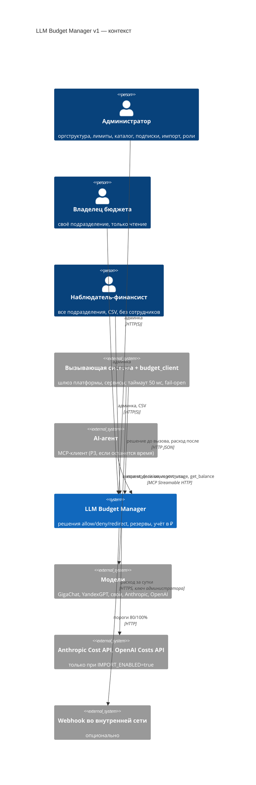
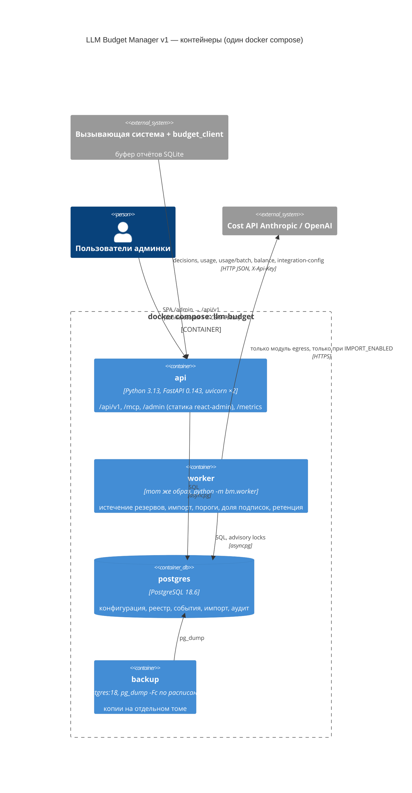
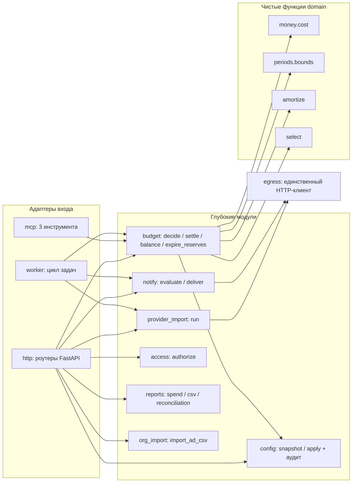

# 12. Решение главного архитектора: LLM Budget Manager v1

**Автор:** главный архитектор (скилл `architecture-judge`). **Дата:** 2026-10-13.
**Входы:** `10_tech_spec.md`, `10_constitution.md`, `10_tech_brief_for_architects.md`, `10_tech_qa.md`, `11_arch_ai.md`, `11_arch_classic.md`, `06_ceo_verdict.md`.
**Выходы:** этот файл, `12_adr/ADR-001…007`, `12_openapi.yaml`, `12_plan.md`, `12_tasks.md`.
**Статус:** ждёт согласия заказчика (блок `APPROVAL` в конце). Разработка не начинается без него.

ML_REQUIRED: no

---

## 1. Решение (коротко)

**Победитель — предложение classic. Берём из предложения ai три небольших элемента, поэтому формально это гибрид на базе classic.** Итог матрицы: гибрид 405, classic 395, ai 365 из 500.

1. **Что строим.** Модульный монолит на Python 3.13 и FastAPI. Один образ и два процесса: `api` и `worker`. PostgreSQL 18 — единственное хранилище. Админка на react-admin собирается в статику и отдаётся тем же `api`. Всё ставится одним `docker compose up` на одной машине. Очередей, Redis и ML нет.
2. **Деньги.** Модуль `budget` — один глубокий модуль: `decide`, `settle`, `balance`, `expire_reserves`. Суммы хранятся в целых копейках. Расход ведётся в суточном реестре по дате расхода. На время решения берётся блокировка строк владельцев бюджета в фиксированном порядке, поэтому параллельные запросы не дают перерасхода. Подписки амортизируются накопительно.
3. **Из ai берём:**
   - привязку субъектов к ключу вызывающей системы (`subject_scope`) — защита от агента, которого склонили тратить чужой бюджет;
   - тест эквивалентности HTTP и MCP одним набором сценариев;
   - поля оценки в решении (`estimate.source`) — по ним после пилота можно будет обучить оценщик без изменения схемы.
4. **Не берём из ai:**
   - токенизатор в SDK (ML-0) и ML-оценку резерва (ML-1). В v1 они не нужны, а рамку по трудоёмкости съедают;
   - изоляцию `api` сетью Docker `internal: true` (ADR-AI-5), потому что она противоречит опубликованному порту `api` (§4.2).
5. **ML_REQUIRED: no.** В MVP нет ни одного ML-компонента, задач для ML-инженера нет.
6. **Стоимость MVP** [Вывод]: 17,7 чел.-нед ≈ 4,09 чел.-мес ≈ 1,96 млн ₽. В объём входят P1 и P2 с обоими коннекторами, уведомления только в админке. MCP и webhook делаются, если на контрольной точке недели 5 факт идёт не хуже плана. Деньги укладываются в 2 млн ₽, но трудоёмкость на 0,09 чел.-мес выше формального порога SC-013 (4 чел.-мес). Это вынесено на решение заказчика (вопрос 1 в APPROVAL).
7. **Срок** [Вывод]: ≈ 10 календарных недель после прохождения Г1 и согласия заказчика. До этого — спайк на 3 дня (§9).

---

## 2. Шаг 1. Допуск: стоп-факторы

| Стоп-фактор (`10_tech_brief_for_architects.md`) | ai | classic |
|---|---|---|
| Нарушение принципов конституции I–IX | Прямых нарушений нет. Три замечания: (а) ML-1 спорен по принципу VI, но в MVP выключен и вынесен в v1.1. (б) tiktoken по умолчанию скачивает файлы кодировок при первом вызове. Это исходящее соединение из SDK, автор сам это отмечает. Исправимо упаковкой файлов. (в) Гарантия принципа IV опирается на `internal: true` для `api`, а `api` нужен опубликованный порт (§4.2). Код-проверка хоста в предложении есть, поэтому гарантия не нулевая | Нарушений нет |
| P1-сценарии 1–3 не выполняются | Выполняются | Выполняются |
| Оценка > 4 чел.-мес без плана урезания, сохраняющего P1 | Полный объём 4,32 чел.-мес. План урезания есть, P1 сохраняется | Полный объём 4,09 чел.-мес. План урезания есть, P1 сохраняется |
| Хранение содержимого или ключей в открытом виде | Нет | Нет |
| Исходящие соединения при выключенном флаге | Защищено кодом и сетью; сетевая часть с изъяном (см. выше) | Защищено кодом (модуль `egress`, import-linter) и двухуровневым тестом |
| Бюджет и гейт CEO (≤ 2 млн ₽ после Г1, Г2 ≈ М4) | Полный объём 2,07 млн ₽ — вне рамки. В рамку попадает только без коннектора OpenAI | Полный объём 1,96 млн ₽ ≤ 2 млн ₽. Трудоёмкость 4,09 чел.-мес |

**Итог:** допущены оба предложения. Предложению ai для победы нужно было бы: упаковать кодировки tiktoken, убрать опору на `internal: true` для `api` и сократить объём до рамки.

---

## 3. Шаг 2. Матрица

Веса взяты из `10_tech_brief_for_architects.md`. Сдвиги там обоснованы: «Время до MVP» 20 (+5) из-за жёсткой рамки ≤ 4 чел.-мес, «Развиваемость» 5 (−5) из-за запрета «на вырост» (принцип VIII). Баллы выставлены по **пересчитанным** числам (§5), а не по самооценкам.

| Критерий | Вес | ai: балл | ai: × вес | classic: балл | classic: × вес | гибрид: балл | гибрид: × вес | Почему |
|---|---|---|---|---|---|---|---|---|
| Соответствие требованиям | 25 | 4 | 100 | 4 | 100 | 4 | 100 | Все FR P1–P2 закрыты детерминированно у обоих. Минусы общие: сутки импорта UTC, а не МСК; SC-001 подтверждается только замером |
| Риск реализации | 15 | 3 | 45 | 4 | 60 | 4 | 60 | У ai — изъян сетевой изоляции, спор о ML-1 и принципе VI, лишняя зависимость в SDK. У classic неизвестна только производительность до спайка |
| Время до MVP | 20 | 3 | 60 | 4 | 80 | 4 | 80 | ai после поправки ≈ 4,55 чел.-мес; даже без OpenAI ≈ 4,11. classic после поправки 4,06 при объёме C |
| Стоимость владения 3 года | 15 | 4 | 60 | 4 | 60 | 4 | 60 | ≈ 6,2–6,6 млн ₽ у ai против ≈ 5,9 у classic. Лицензий, GPU и токенов нет у обоих |
| Регуляторика и безопасность | 10 | 4 | 40 | 4 | 40 | 5 | 50 | Гибрид = двухуровневый тест egress от classic + привязка субъектов к ключу от ai |
| Эксплуатация | 10 | 4 | 40 | 4 | 40 | 4 | 40 | Одна машина, fail-open, бэкап, видимое отставание импорта |
| Развиваемость | 5 | 4 | 20 | 3 | 15 | 3 | 15 | У ai есть готовый шов `TokenEstimator`. У classic его нет (один адаптер — гипотетический шов) |
| **Итого** | **100** | | **365** | | **395** | | **405** | |

**Почему проиграло предложение ai.** Детерминированное ядро у обоих по сути совпадает, и автор ai сам это признаёт (§8.1, §16). Разница — в добавках. ML-0 и ML-1 дают выигрыш только после пилота, а в рамке трудоёмкости места для них нет. Опора на `internal: true` для `api` технически противоречива. Оценка ai не учитывает работу техлида (≈ 1,0 чел.-нед), поэтому в рамку не попадает даже после отказа от коннектора OpenAI.

**Что изменится, если заказчик выберет ai.**
- В SDK появится токенизатор (+0,3 чел.-нед), а в `worker` в v1.1 — квантильная оценка резерва (+1,5 чел.-нед).
- Общая трудоёмкость ≈ 19,7 чел.-нед ≈ 4,55 чел.-мес ≈ 2,18 млн ₽. Это вне обеих рамок. Чтобы вернуться в рамку, нужно урезать MCP, webhook, OpenAI и ML-0, причём и после этого остаётся ≈ 4,1 чел.-мес.
- Ядро, OpenAPI и задачи P1 почти не изменятся. Добавятся поля `input_chars` и `tokenizer_hints` в контракте, а также задачи для роли ml.

---

## 4. Итоговая архитектура

### 4.1. C4 L1 — контекст

### 4.2. C4 L2 — контейнеры

**Сети compose.** `postgres` и `backup` подключены только к сети `core` с `internal: true`: им наружу не нужно. `api` и `worker` подключены к `core` и `edge`; `edge` нужна для опубликованного порта `api` и webhook во внутреннюю сеть. Поэтому принцип IV для `api` и `worker` гарантируют код и тест, а не сеть (ADR-006). Порт `api` по умолчанию публикуется на `127.0.0.1:8080` (`BIND_ADDR`).

### 4.3. C4 L3 — модули `api` и `worker`

Интерфейсы модулей и сигнатуры — в `12_plan.md`, §4.

### 4.4. Ключевые правила (закрывают вопросы из задания архитекторам)

| Вопрос | Решение | ADR |
|---|---|---|
| p95 ≤ 10 мс при 50 rps | Конфигурация хранится снимком в памяти процесса, версия снимка проверяется одним запросом. Транзакция решения — 4 обращения к БД. Если спайк не уложится в p95, план Б: держать в `budget_lock` текущие суммы дня, недели и месяца, без `SUM`. Новых компонентов не добавляем | 002 |
| Подтверждённые отчёты не теряются (SC-003) | Ответ 200 отдаётся только после COMMIT при `synchronous_commit=on` | 002 |
| Перерасход ≤ 2% (SC-004) | Строки `budget_lock` сотрудника и подразделения блокируются `FOR UPDATE` в порядке (owner_type, owner_id). Гонки дают нулевой перерасход. Остаточный перерасход возможен в трёх случаях: факт > оценки, fail-open, поздний импорт — все три видны по флагам | 002 |
| Остаток по FR-026 до копейки (SC-007) | Одна функция `Budget.balance()`: лимит − Σ `ledger_daily` (token + import) за дни периода − резервы − амортизация подписок. Суммы в целых копейках, одно округление ROUND_HALF_UP на событие | 003 |
| Импорт: задержка, уточнения, поздние данные, один способ учёта | Сутки UTC провайдера считаются датой расхода. Upsert по (provider, source_ref, model, day): при изменении суммы в реестр пишется дельта. Поздние данные ложатся в свой день. У источника ровно один `mode`: `import` или `decision_api` | 004 |
| Самая дешёвая совместимая модель | Чистая функция `select()`. Порядок: (оценка, `tie_order`, id). Эмбеддинги отсекаются до поиска. Учитываются все применимые лимиты | 003 |
| Ключи провайдеров, ноль исходящих соединений | Ключи только в окружении или `*_FILE`, их читает только `worker`. Единственный HTTP-клиент — модуль `egress` с allowlist. import-linter запрещает сетевые библиотеки в остальных пакетах. Проверка двухуровневая: подмена `socket` в pytest и счётчик пакетов на хосте | 006 |
| MCP и HTTP — одна семантика | Оба — тонкие адаптеры над `Budget`. Тест эквивалентности гоняет один набор сценариев через оба адаптера | 007 |
| Отказ — это результат решения, а не ошибка | `POST /decisions` всегда отвечает 200 с `outcome`. Подсказка `http_status_hint` = 403/422/429 нужна, чтобы клиент не спутал отказ со сбоем утилиты, который ведёт к fail-open | 005 |

### 4.5. Алгоритм решения (нормативно, для реализации)

1. **Субъект.** Сотрудник ищется по `login` с активным назначением на сегодня по МСК. Не найден — `deny subject_unknown`. Для `service` субъект — сам ключ, подразделение берётся из ключа. Если субъект вне `subject_scope` ключа — `403 subject_out_of_scope`. Это ошибка доступа, а не решение, и она пишется в аудит.
2. **Модель.** Модели нет в каталоге или она неактивна — `deny model_unknown`.
3. **Разрешённость.** Модель не входит в `allowed_models` подразделения:
   - при `enforce` — `deny model_not_allowed`;
   - при `observe` и `warn` — `allow` с `observed_violation=model_not_allowed` (вопрос 5 в APPROVAL).
   Пустой список означает «ничего не разрешено».
4. **Оценка.**
   - `in = input_tokens ?? model.default_input_tokens`;
   - `out = max_output_tokens ?? model.default_output_tokens`;
   - `cost = money.cost(in, out, 0, price_now, fx)`, где `fx` — курс месяца сегодняшней даты по МСК.
5. **Лимиты.** Применимы все заданные лимиты сотрудника и его подразделения × (день, неделя, месяц). `remaining = limit − spent − reserved − amort`. Если лимитов нет — ограничения нет.
6. **Если `cost == 0` или `cost ≤ min(remaining)`** — `allow`, `reserve = cost`.
7. **Иначе:**
   - при `observe` и `warn` — `allow` с `observed_violation=budget_exceeded`;
   - при `enforce` и `kind=embedding` — `deny budget_exceeded`;
   - при `enforce` и `kind=chat` — ищутся кандидаты. Условия: модель разрешена, активна, `kind=chat`, (`tools` ⇒ `supports_tools`), (`json_mode` ⇒ `supports_json`), `max_context ≥ context_tokens`, `cost_c == 0 или cost_c ≤ min(remaining)`. `cost_c` считается на тех же `in` и `out`; если `max_output_tokens` не передан, берётся `out` по умолчанию у кандидата. Кандидаты сортируются по (`cost_c`, `tie_order`, `id`). Первый — `redirect`, `reason=budget_exceeded`, `reserve=cost_c`. Кандидатов нет — `deny budget_exceeded`.
8. **Применённый лимит** — лимит с минимальным `remaining`. При равенстве порядок такой: сначала сотрудник, затем подразделение; внутри — день, неделя, месяц. В ответе: `resets_at` по МСК; `budget_blocked_by_subscriptions=true`, если амортизация за период ≥ лимита.
9. **Запись.** `decision_id` (UUIDv7) и строка `call_record` пишутся для любого исхода. Резерв — только для `allow` и `redirect`, в той же транзакции, вместе с `budget_lock.reserved_kop += reserve`.

### 4.6. Данные (сводно; DDL — `12_plan.md` §5)

Таблицы: `department`, `employee` (pseudonym — случайный и уникальный; login видит только администратор), `employee_assignment` (история), `caller_system` (SHA-256 ключа, `subject_scope`, `provider_source_id`), `limit_def`, `dept_model_allow`, `model`, `model_price` (история), `fx_rate`, `budget_lock`, `call_record` (партиции по месяцам), `ledger_daily`, `subscription` (денежные поля неизменяемы), `subscription_month` (фиксация курса и суммы месяца), `provider_source`, `import_line`, `import_run`, `notification`, `agg_daily`, `admin_user`, `session`, `audit_log` (только INSERT), `config_version`, `job_run`.

**Ретенция.** Партиции `call_record` и строки `ledger_daily` сотрудников живут 12 мес. `agg_daily` и строки `ledger_daily` подразделений живут 36 мес. Объём при 50 rps × 8 ч × 21 день — до ≈ 9–11 ГБ/мес детальных данных (оценка classic, [Гипотеза]). Диск — от 200 ГБ.

### 4.7. NFR

| NFR | Цель | Как проверяем |
|---|---|---|
| SC-001 | p95 ≤ 10 мс, p99 ≤ 25 мс внутри; p95 ≤ 20 мс у клиента | `make load`: vegeta, 50 rps × 10 мин, гистограмма `/metrics`. Стенд: 4 vCPU x86-64, 8 ГБ RAM, NVMe ≥ 200 ГБ, Linux, Docker Engine + compose v2. `api` ×2 uvicorn, `shared_buffers=1GB` (обе стороны выбрали одинаковый стенд) |
| SC-002, SC-003 | 100% fail-open / fail-closed, 0 потерь | `make failover`: `docker compose stop` и `kill -9` под нагрузкой |
| SC-004 | ≤ 2% | 3 клиента × 50 одновременных запросов на границе. Σ резервов ≤ остатка строго; при факте = оценке × 1,1 перерасход ≤ 2% |
| SC-012 | 99,5% в рабочее время | Один узел, `restart: unless-stopped`, healthcheck. Сбой не останавливает AI благодаря fail-open |
| Наблюдаемость | — | JSON-логи без содержимого и секретов, `/metrics`, страница «Состояние» (импорт, `job_run`) |

### 4.8. Безопасность и регуляторика

- **Принцип I.** Схемы API с `additionalProperties: false`; в БД нет текстовых полей для содержимого; псевдонимы; тест SC-011.
- **Принцип II.** `ANTHROPIC_ADMIN_KEY` и `OPENAI_ADMIN_KEY` задаются в окружении или через `*_FILE` (Docker secrets). В БД, логах, UI и бэкапах их нет. API отдаёт только `configured: true/false`.
- **Принцип IV.** ADR-006. Тест «0 исходящих соединений» — гейт релиза.
- **Принцип V.**
  - Лицензии из белого списка.
  - psycopg 3 (LGPL-3) и k6 (AGPL) не берём; разбираться с LGPL не нужно, asyncpg — Apache-2.0.
  - Пакеты Enterprise Edition react-admin (`@react-admin/ra-*`) запрещены правилом проверки лицензий.
  - В CI: SBOM (CycloneDX), pip-audit, npm audit, Trivy.
- **Доступ.**
  - Ключ вызывающей системы: `bm_<prefix>_<secret>`, в БД хранится SHA-256, есть `subject_scope`.
  - Админка: argon2id, cookie `HttpOnly; SameSite=Strict`, заголовок `X-CSRF-Token`, блокировка после 10 неудачных попыток [Гипотеза].
  - `authorize()` работает в сервисном слое, отказы пишутся в аудит.
- **152-ФЗ и ТК РФ.** Новое подразделение создаётся в режиме `observe`. Режим `enforce` включается только после локального акта — это зависимость у заказчика. Юристу: подтвердить, что импорт агрегатов по workspace и проекту не является трансграничной передачей ПДн (D5).

---

## 5. Пересчёт чисел архитекторов

Ставка 0,48 млн ₽ за чел.-мес (`06_ceo_verdict.md` §2), 1 чел.-мес = 4,33 чел.-нед. Рамка SC-013: 4 чел.-мес = 17,32 чел.-нед = 1,92 млн ₽.

| Показатель | Заявлено | Пересчёт главного архитектора | Оценка |
|---|---|---|---|
| ai, полный объём | 18,7 чел.-нед ≈ 4,32 чел.-мес ≈ 2,07 млн ₽ | Сумма по блокам 18,7 сходится. Не учтены ревью, приёмка и документация администратора: техлид ≈ +1,0 (у ai только 0,5 на «архитектор и техлид»). Итого ≈ 19,7 → 4,55 чел.-мес → 2,18 млн ₽ | **Занижено ≈ на 5%** [Вывод] |
| ai, «ядро P1» | 11,9 чел.-нед | Админка не включена, хотя сценарий 3 проверяется через неё (F1 частично ≈ 1,0–1,5) | Занижено |
| ai, после урезания (шаг 4) | 16,8 → 3,88 чел.-мес → 1,86 млн ₽ | С учётом техлида ≈ 17,8 → 4,11 → 1,97. В рамку 4 чел.-мес не попадает | Занижено |
| ai, стоимость владения за 3 года | 6,2–6,6 млн ₽ | Сопровождение посчитано за 36 мес вместо 33 мес после релиза: завышение 0,36 млн ₽ | Слегка завышено |
| ai, срок 8 недель | 3 человека | Критический путь B1 → B3 → B4 → S1 = 6,5 нед одного backend, затем QA-гейт. 8 недель — без запаса | Оптимистично |
| classic, полный объём | 17,7 → 4,09 → 1,96 | Сумма по ролям (6,2 + 5,0 + 2,5 + 1,0 + 1,5 + 1,5) = 17,7 сходится | Арифметика верна |
| classic, объём C (обязательство) | 17,1 → 3,95 → 1,90 | Нет дизайнера (+0,3, этап 5 процесса). Импорт: у classic 1,8, у ai 2,3, беру 2,0 (+0,2), потому что форматы API сверяются только на спайке. Итого 17,6 → 4,06 → 1,95 | **Занижено на 3%**; «в рамке» — неверно |
| classic, стоимость владения за 3 года | ≈ 5,9 млн ₽ | 1,90 + 0,12 × 33 = 5,86 | Верно |
| classic, срок 10 недель | — | Критический путь BE1 6,2 → 6,5 нед + QA | Реалистично |

### 5.1. Итоговая оценка гибрида по ролям (чел.-нед) [Вывод: экспертная, без учёта ускорения от AI-агентов]

| Роль | Работы | Чел.-нед |
|---|---|---|
| Backend 1 (деньги) | Схема и реестр 1,5; `decide` с `subject_scope` 1,6; `settle` 1,0; импорт, общая часть 0,9; Anthropic 0,5; OpenAI 0,6; *MCP 0,4* | 6,5 |
| Backend 2 (конфигурация) | Конфигурация и импорт AD 1,5; подписки и курсы 1,0; уведомления 0,3 + *webhook 0,2*; вход, роли, аудит, отчёты 1,2; `budget_client` и отказной стенд 0,8 | 5,0 |
| Frontend | react-admin: CRUD, панель, подписки с предпросмотром, отчёты, состояние | 2,5 |
| Дизайнер | Минимальные макеты 8 экранов, токены | 0,3 |
| DevOps | Compose, образы, backup и restore, `make check`, тест egress на хосте | 1,0 |
| QA | Нагрузочный, отказной, kill-тест, матрица ролей, отсутствие содержимого, восстановление | 1,5 |
| Техлид | Ревью, приёмка, документация администратора и интеграции | 1,5 |
| **Полный объём** | | **18,3 ≈ 4,23 чел.-мес ≈ 2,03 млн ₽** |
| **Рекомендуемый объём (без MCP и webhook)** | | **17,7 ≈ 4,09 чел.-мес ≈ 1,96 млн ₽** |
| Строго в 4 чел.-мес (ещё без коннектора OpenAI) | | 17,1 ≈ 3,95 чел.-мес ≈ 1,90 млн ₽ |

**Реализация AI-агентами.** По условию задачу реализуют AI-агенты за один проход. Это может заметно снизить трудоёмкость [Гипотеза: замеров нет], но в оценку и стоимость это не закладывается. Факт против плана замеряется на контрольной точке недели 5. При опережении в объём возвращаются MCP, затем webhook.

**Стоимость владения за 3 года** [Вывод]: 1,96 (разработка) + 0,12 × 33 (сопровождение 0,25 FTE, допущение движка) = **≈ 5,9 млн ₽** + существующий сервер (цены нет во входах). Лицензий, GPU и токенов нет. Пересчёт экономики «lite-утилиты» в движке — поручение финансисту (D2), не моё.

---

## 6. Открытые вопросы архитекторов — разрешение

| # | Вопрос (источник) | Решение | Кто решает |
|---|---|---|---|
| 1 | Цена в USD, а курс не вводился ни разу (ai Q-A1, classic Q6) | Сохранить USD-цену модели или USD-подписку нельзя, пока нет ни одного курса: `422 fx_rate_missing`. Новый код отказа не нужен, FR-002 не меняется | Главный архитектор |
| 2 | Сутки импорта UTC или МСК (ai Q-A2, classic Q3) | Сутки UTC провайдера считаются датой расхода, сверка SC-005 ведётся в тех же сутках | **Заказчик** — APPROVAL, вопрос 4 (до ответа работаем по рекомендации) |
| 3 | Толкование принципа VI для ML-1 (ai Q-A3) | Снят: ML вне v1. Поля `estimate` сохраняются для будущего | — |
| 4 | Отказ как HTTP 200 или 403/429 (ai Q-A4) | 200 + `outcome=deny` + `http_status_hint` (ADR-005) | **Заказчик** — APPROVAL, вопрос 6 |
| 5 | Пример 4.1: 241,94 или 241,93 (classic Q1) | Накопительное округление, то есть 241,93 ₽. Пример 4.1 исправить | **Заказчик** — APPROVAL, вопрос 3 |
| 6 | `observe`/`warn` при неразрешённой модели (classic Q2) | Смягчаются `budget_exceeded` и `model_not_allowed`. `model_unknown` и `subject_unknown` — отказ всегда: без каталога и субъекта учёт невозможен | **Заказчик** — APPROVAL, вопрос 5 |
| 7 | Источник Anthropic — только workspace (classic Q4) | Да: `cost_report` группирует только по `workspace_id` и `description` [Факт, [Anthropic](https://platform.claude.com/docs/en/build-with-claude/usage-cost-api)]. Источник `api_key` для Anthropic отклоняется с `422 unsupported_source_kind`. Техлиду — уточнить FR-022 | Главный архитектор + техлид |
| 8 | Дата расхода факта (classic Q5) | Дата решения по МСК. Для отчёта без решения — `occurred_at`, но не раньше 7 суток назад [Гипотеза] | Главный архитектор |
| 9 | Как вызывающая сторона узнаёт `fail_mode` подразделения, зная только логин | Решение содержит `department_id` и `fail_mode`, клиент кэширует их по субъекту. `integration-config` отдаёт `default_fail_mode` и список подразделений с их `fail_mode` (FR-006) | Главный архитектор |
| 10 | Курс изменён задним числом и подписки | Сумма подписки за месяц фиксируется в `subscription_month` при первом расчёте месяца и потом не пересчитывается. Денежные поля подписки неизменяемы: чтобы изменить подписку, её закрывают датой и создают новую [Гипотеза, согласовано с «не пересчитывать списанное»] | Главный архитектор |
| 11 | Цена кэшированных токенов не задана | Кэшированные токены тарифицируются по цене входа | Главный архитектор |
| 12 | Отклонение D3 — чем заменить прототип LiteLLM для Г1 | Спайк на 3 дня (§9). Финансовый критерий Г1 (≥ 18 млн ₽/год) остаётся | **Заказчик и CEO** — APPROVAL, вопрос 2 |

---

## 7. Стек (версии — `12_plan.md` §2)

Python 3.13 · FastAPI 0.143.0 (MIT) [Факт, [PyPI](https://pypi.org/project/fastapi/), 08.10.2026] · Pydantic v2 · uvicorn · asyncpg 0.32.0 (Apache-2.0) [Факт по ссылке classic, [PyPI](https://pypi.org/project/asyncpg/)] · mcp 2.3.0 (MIT, Streamable HTTP) [Факт, [PyPI](https://pypi.org/project/mcp/), 02.10.2026; монтирование в ASGI проверяется на спайке] · PostgreSQL 18.6 (PostgreSQL License, EOL 14.11.2030) [Факт, [postgresql.org](https://www.postgresql.org/support/versioning/)] · httpx · argon2-cffi · prometheus-client · tzdata · react-admin 5 (MIT-ядро, без EE) [Факт, [marmelab](https://marmelab.com/react-admin/Readme.html)] · React · MUI core · Vite · TypeScript · vitest · pytest · vegeta (MIT) · Docker Engine + compose v2. Точные версии без пометки [Факт] фиксируются lock-файлами в задаче T001, их лицензии проверяет SCA.

**Предложение ai указывает устаревшие версии** (FastAPI 0.136.1, mcp 1.27.x). Берём актуальные. mcp 2.x — новая мажорная версия, поэтому её API сверяется на спайке (день 2).

---

## 8. Риски

| # | Риск | В / П | Мера | Владелец |
|---|---|---|---|---|
| R-1 | Трудоёмкость без запаса: 4,09 чел.-мес против рамки 4,0 | Высокая / Высокое | Объём C, контрольная точка недели 5, урезание: MCP → webhook → OpenAI. Стоп по SC-013 при прогнозе > 4,17 чел.-мес (2 млн ₽) | Техлид |
| R-2 | Python и PostgreSQL не дают p95 ≤ 10 мс | Низкая–средняя / Высокое | Спайк день 1, план Б внутри PostgreSQL (§4.4). Другой язык — только при провале спайка | Backend 1 |
| R-3 | Формат Cost API меняется, корзины в UTC, уточнения после 7 суток | Средняя / Среднее | Записанные ответы в тестах, окно `IMPORT_WINDOW_DAYS`, изоляция в `worker` | Backend 1 |
| R-4 | Вызывающие стороны не встраивают клиент или игнорируют отказы (R-5 спецификации) — Г2 «учёт ≥ 95%» | Высокая / Высокое | Готовый `budget_client`, флаг `decision_not_followed`, сверка с импортом, рекомендация закрыть прямой доступ к провайдерам | Владелец платформы |
| R-5 | API mcp 2.x не монтируется в ASGI так, как ожидается | Средняя / Низкое | Спайк, день 2. MCP и так первым уходит под урезание | Backend 1 |
| R-6 | Тест «0 исходящих соединений» ненадёжен на хосте пользователя | Средняя / Среднее | Переносимый уровень (подмена `socket`) в `make test`, счётчик `DOCKER-USER` — на стенде QA | DevOps |
| R-7 | Экономика «lite-утилиты» не пересчитана (D2), Г1 не пройден | Средняя / Критическое | Разработка только после Г1 (вопрос 2) | CPO + финансист |

---

## 9. Спайк вместо прототипа LiteLLM (ответ на D3), ≤ 3 дня, бюджет P0

| День | Что | Критерий «дальше» |
|---|---|---|
| 1 | `POST /decisions` с `budget_lock`, `ledger_daily`, `call_record`. vegeta 50 rps × 10 мин на эталонном стенде. 3 клиента × 50 запросов на границе лимита | p95 ≤ 10 мс внутри и ≤ 20 мс у клиента, p99 ≤ 25 мс; Σ резервов ≤ остатка |
| 2 | Тестовые ключи администратора: Anthropic `cost_report`, OpenAI `/organization/costs` за 7 суток. Записать фикстуры: границы UTC, поля сумм и валюты, пагинация, повторная загрузка. Смонтировать mcp 2.3 в ASGI | Строки за сутки D сходятся с консолью провайдера; повторная загрузка не меняет итогов; MCP-инструмент отвечает |
| 3 | `budget_client`: таймаут 50 мс, fail-open, буфер, `kill` утилиты. Отчёт | 100% вызовов проходят, 100% досылки без дублей |

**Стоп или пересмотр:** p95 > 20 мс у клиента даже с планом Б или Cost API недоступен из контура заказчика (тогда коннекторы выходят из v1, −1,6 чел.-нед).

---

## 10. Согласование

История решений. Решение заказчика техлид фиксирует здесь и в `12_approval_log.md`.

| Дата | Версия решения | Ответ заказчика | Изменения |
|---|---|---|---|
| 2026-10-13 | 1.0 — гибрид на базе classic, объём C | ожидается | — |

---

APPROVAL:
Рекомендую: гибрид на базе предложения classic. Это детерминированное ядро без ML: Python 3.13 + FastAPI + PostgreSQL 18, один docker compose. Из предложения ai берём привязку субъектов к ключу и тест эквивалентности HTTP и MCP. Объём v1: P1 + P2 с обоими коннекторами (Anthropic, OpenAI), уведомления в админке. MCP и webhook делаем, только если на контрольной точке недели 5 факт не хуже плана.
Стоимость MVP: 17,7 чел.-нед ≈ 4,09 чел.-мес ≈ 1,96 млн ₽ [Вывод]. Это в рамке 2 млн ₽, но на 0,09 чел.-мес выше порога 4 чел.-мес из SC-013. За 3 года с сопровождением 0,25 FTE ≈ 5,9 млн ₽ + сервер. Срок: ≈ 10 календарных недель после Г1 и вашего согласия; перед этим спайк 3 дня.
Главный риск: в трудоёмкости нет запаса (R-1). Любое отставание ведёт к урезанию (MCP → webhook → коннектор OpenAI) или к остановке по SC-013.
Альтернатива: предложение ai целиком — то же ядро плюс токенизатор в SDK и ML-оценка резерва после пилота. Плюс — точнее резерв в будущем. Минус — ≈ 4,55 чел.-мес ≈ 2,18 млн ₽ после поправки, вне рамки даже без коннектора OpenAI.
Вопросы на ваше решение (варианты, рекомендация):
1. Рамка трудоёмкости. А) принять 4,09 чел.-мес / 1,96 млн ₽ с обоими коннекторами; Б) строго ≤ 4 чел.-мес: коннектор OpenAI уходит из v1, расход OpenAI учитывается через Decision API (3,95 чел.-мес / 1,90 млн ₽); В) полный объём с MCP и webhook (4,23 чел.-мес / 2,03 млн ₽, вне рамки). Рекомендую А.
2. Старт разработки. А) спайк 3 дня сейчас, разработка после Г1 (расход ≥ 18 млн ₽/год + спайк вместо прототипа LiteLLM, отклонение D3); Б) разработка сразу, без Г1. Рекомендую А: так требует конституция.
3. Округление подписок. А) накопительное: сумма за месяц всегда равна цене подписки, в примере 4.1 доля за день — 241,93 ₽; Б) по каждому периоду отдельно: 241,94 ₽, но сумма дней расходится с месяцем на копейки. Рекомендую А.
4. Сутки импорта. А) сутки UTC провайдера считаются датой расхода (сдвиг 3 ч от МСК; другого API не отдаёт); Б) почасовые токены × цена каталога по суткам МСК — это уже не фактическая стоимость провайдера. Рекомендую А.
5. Режимы «наблюдать» и «предупреждать». А) смягчают отказ и по бюджету, и по неразрешённой модели; неизвестные модель и субъект — отказ всегда; Б) смягчают только отказ по бюджету. Рекомендую А.
6. Отказ в HTTP API. А) ответ 200 с outcome=deny и подсказкой 403/429, чтобы отказ не путался со сбоем утилиты; Б) HTTP-статус 403/429. Рекомендую А.
Ответьте: «согласен» / «альтернатива» / «гибрид» / свои правки.
