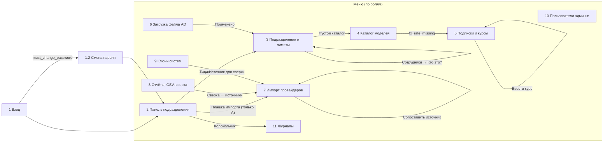

# Дизайн админки LLM Budget Manager v1

**Задача:** T003 (`12_tasks.md`). **Входы:** `10_tech_spec.md`, `10_constitution.md`, `12_arch_decision.md`, `12_openapi.yaml`, `12_plan.md`, `12_tasks.md`.
**Выходы:** этот файл, [`design/screens.md`](design/screens.md) (8 экранов T003 и 3 вспомогательных), [`design/tokens.json`](design/tokens.json).
**Статус:** готов к приёмке техлидом; вопросы В1–В7 закрыты решениями [`13_design_rulings.md`](13_design_rulings.md), контракт — `12_openapi.yaml` 1.0.1 (см. §12). Чек-лист «у каждого FR-027…FR-031 есть экран» — [`design/screens.md`, матрица FR → экран](design/screens.md#экраны-админки-llm-budget-manager-v1-t003).

## 1. Итог

- Админка — плотный рабочий инструмент: таблицы и формы на react-admin (MIT-ядро, MUI core). Собственный компонент один — **шкала бюджета периода** (`PeriodBudgetMeter`). Он показывает, из чего сложился расход: подписки, импорт, токены, резервы, остаток, а также отметку 80% и выход за лимит. На этой шкале держится весь характер интерфейса, остальное намеренно сдержанное.
- Каждый экран привязан к операциям `12_openapi.yaml`. Видимость по ролям взята из `x-roles` (1.0.1). Расхождения со спецификацией, найденные при проектировании, закрыты решениями техлида — см. §11 и §12.
- Шрифты только системные, внешних URL нет, тёмная тема есть. Контраст текста — WCAG AA и выше (§8).
- Прототип `design/prototype.html` не делался: его нет в T003, а 0,3 чел.-нед ушли на спецификацию экранов.

## 2. Принципы и характер интерфейса

1. **Для кого.** Три роли, три задачи. Администратор из ИТ настраивает систему раз в месяц и разбирает инциденты. Владелец бюджета (руководитель подразделения) раз в несколько дней смотрит, сколько осталось. Финансист в конце месяца выгружает CSV и сверяет данные.
2. **Тон — расчётная ведомость, а не маркетинговый дашборд.** Сумма всегда видна целиком, до копейки, в рублях. Каждое число можно раскрыть до строк, из которых оно сложилось (принцип VI, FR-026). Без «героев» и декоративной графики.
3. **Плотность высокая, иерархия строгая.** Базовый кегль 14 px, таблицы 13 px. Цифры моноширинные по ширине (`tabular-nums`) и выровнены вправо. Колонки складываются глазами, как в бухгалтерской книге.
4. **Объяснять, а не пугать.** Каждый отказ, предупреждение и пустой экран говорит, что произошло и что делать дальше. Время — всегда «по МСК», сутки импорта — всегда «сутки UTC».
5. **Одна смелость.** Шкала бюджета с цветами источников и штриховкой резервов и перерасхода. Цвета источников повторяются везде, где упоминается источник: в чипах, легендах, отчётах.

## 3. Визуальное направление

**План.**
- Палитра: «бумага ведомости» `#F1F4F2` (холодный серо-зелёный фон) и белые панели. Чернила `#17222B`. Кобальт `#2F55C8` — токены и действия. Бирюза `#0F7563` — импорт. Слива `#7B3F98` — подписки. Сургучно-красный `#B42318` — только перерасход и ошибки.
- Шрифты: системный sans (`system-ui`, Segoe UI, Roboto, Noto Sans, PT Sans…). Кириллица есть во всех шрифтах стека. Моноширинный — только для машинных идентификаторов: `emp-…`, ключ, id модели, `ref` источника.
- Раскладка: левое меню, рабочая область до 1440 px, выравнивание по левому краю, деньги — по правому. Панели отделяются тонкой рамкой, а не тенью.

**Проверка плана на шаблонность и что изменено.**
- Первый вариант был «набор SaaS-карточек»: три одинаковые карточки «Сутки / Неделя / Месяц» с большим числом и круговым индикатором. Это шаблон, и круговой индикатор не передаёт главное — состав расхода и перерасход. Заменено на три горизонтальные шкалы одной длины в масштабе лимита: периоды сравниваются построчно, а перерасход виден как выход за правый край.
- Тёмная тема на почти чёрном с одним кислотным акцентом отвергнута. Тёмная тема — графит `#161C21` с теми же четырьмя смысловыми цветами, только осветлёнными.
- Отказ от подписей капслоком, «надзаголовков» над каждым блоком, разделителей «·» в метастроках и стрелок «→» в кнопках. Нумерация шагов есть только там, где это настоящая последовательность: загрузка файла AD, проверка, применение.
- Радиусы различаются по иерархии: 0 — ячейки и сегменты шкалы, 3 px — элементы управления, 6 px — панели и диалоги.

**Движение.** Анимируется только ответ на действие: раскрытие строк, появление диалога, пересчёт предпросмотра подписки (значения плавно сменяются за 200 мс). Анимации при загрузке страницы нет. `prefers-reduced-motion` обнуляет длительности.

## 4. Карта экранов и навигация

**Меню по ролям** (порядок пунктов фиксирован; недоступные пункты не показываются):

| Пункт меню | Экран | Администратор | Владелец бюджета | Наблюдатель-финансист |
|---|---|---|---|---|
| Панель | 2 | ✓ | ✓ (своё) | ✓ |
| Подразделения | 3 | ✓ | ✓ «Моё подразделение» | ✓ |
| Модели | 4 | ✓ | ✓ чтение | ✓ чтение |
| Подписки и курсы | 5 | ✓ | ✓ подписки, без курсов | ✓ чтение |
| Загрузка файла AD | 6 | ✓ | — | — |
| Импорт провайдеров | 7 | ✓ | — | ✓ только «Состояние» |
| Отчёты | 8 | ✓ | ✓ без сверки | ✓ |
| Ключи систем | 9 | ✓ | — | — |
| Пользователи | 10 | ✓ | — | — |
| Журналы | 11 | ✓ события, аудит, уведомления | ✓ события, уведомления | — |

Шапка: название «Бюджеты LLM», колокольчик уведомлений (А, В), переключатель темы, меню пользователя (логин, роль, «Сменить пароль», «Выйти» → `logout`). Роль и подразделение пользователя берутся из `me` при загрузке приложения. Меню и маршруты строятся из той же таблицы прав, что и `x-roles`, чтобы не разойтись с `PERMISSIONS` бэкенда.

## 5. Потоки

Сценарии US1 и US2 (P1) выполняются вызывающими системами через API и своего интерфейса не имеют. В админке их результат виден на панели (2) и в журнале событий (11). Поэтому потоки ниже описывают людей, а US1/US2 входят в поток B как наблюдение.

### Поток A — первичная настройка (US3, P1)
| Шаг | Экран | Действие пользователя | Операции API | Решение пользователя |
|---|---|---|---|---|
| 1 | 1 Вход | логин и пароль из `ADMIN_INITIAL_*` | `login` | — |
| 2 | 1.2 Смена пароля | новый пароль ≥ 12 символов | `changePassword` | — |
| 3 | 6 Загрузка AD | выбор CSV, просмотр сводки | `importOrg` (`dry_run=true`) | применять ли, если есть ошибки строк или выведенные сотрудники |
| 4 | 6 | «Применить изменения» | `importOrg` (`dry_run=false`) | — |
| 5 | 5 Курсы | курс USD/₽ на месяц (если будут USD-цены) | `putFxRate` | — |
| 6 | 4 Модели | добавить модели, цены, возможности | `createModel` | порядок при равной цене |
| 7 | 3 Подразделения | разрешённые модели, режим, поведение при недоступности | `updateDepartment` | «Наблюдать» или «Ограничивать» (диалог о локальном акте) |
| 8 | 3 | лимиты в сутки, неделю, месяц; личные лимиты | `putDepartmentLimits`, `putEmployeeLimits` | какие периоды ограничивать |
| 9 | 9 Ключи | выдать ключ системе, сохранить из диалога | `createCaller` | от чьего имени работает система |
| 10 | 2 Панель, 11 События | убедиться, что решения и расход появились | `getDepartmentBalance`, `listEvents` | — |

### Поток B — наблюдение за решениями и расходом (US1, US2, US6.1; P1/P2)
| Шаг | Экран | Действие | Операции | Решение |
|---|---|---|---|---|
| 1 | 2 Панель | владелец видит остаток, шкалы, дату сброса | `getDepartmentBalance`, `getDepartment` | нужен ли разговор о лимите |
| 2 | 2 | «Показать строки» у токенов | `listDepartmentBalanceItems?source=token` | — |
| 3 | 2 | «По моделям» — какая модель тратит | `getSpendReport?group_by=model,source` | — |
| 4 | 11 События | фильтр «Решение: отказ», «Пометка: решение не выполнено» | `listEvents?outcome=deny`, `?flag=decision_not_followed` | какую систему разбирать |
| 5 | 3 (А) | «Кто это?» по псевдониму, с записью в аудит | `revealPseudonym` | — |

### Поток C — ввод подписки с предпросмотром доли (US4, P2)
| Шаг | Экран | Действие | Операции | Решение |
|---|---|---|---|---|
| 1 | 5 Подписки | «Ввести подписку» | — | — |
| 2 | 5.2 | провайдер, тариф, цена, мест, даты, назначение | `listDepartments`, `listEmployees` | на кого списывать |
| 3 | 5.2 | панель «Доля бюджета» обновляется на лету | `previewSubscription` (через 400 мс после изменения) | сохранять ли при доле ≥ порога или ≥ 100% |
| 4 | 5.2 | при `fx_warning` — «Ввести курс» в соседней вкладке | `putFxRate` | — |
| 5 | 5.2 | «Сохранить подписку» | `createSubscription` | — |
| 6 | 2 Панель | сегмент «подписки» на шкалах, пометка доли | `getDepartmentBalance` | — |
| 7 | 5.3 | позже — «Закрыть с даты» или «Закрыть сегодня» | `endSubscription` / `deleteSubscription` | дата последнего дня списания |

### Поток D — подключение импорта провайдеров (US5, P2)
| Шаг | Экран | Действие | Операции | Решение |
|---|---|---|---|---|
| 1 | 7 Состояние | видит «Импорт выключен» / «Ключ не задан» с подсказкой про переменные окружения | `getImportStatus` | включать ли (на сервере, вне UI) |
| 2 | 7 Источники | добавить workspace или проект → подразделение | `createProviderSource` | «Списывать» или «Только сверка» |
| 3 | 7 Состояние | «Загрузить сейчас» | `runImport` → `202` | окно суток |
| 4 | 7 Запуски | дождаться `ok`, посмотреть число строк | `listImportRuns` | — |
| 5 | 7 Состояние | несопоставленные источники → «Сопоставить» | `createProviderSource` | какое подразделение |
| 6 | 8 Сверка | расхождение по источникам «Только сверка» | `getReconciliation` | — |

### Поток E — финансист: месячная выгрузка и сверка (US6.2, P2)
| Шаг | Экран | Действие | Операции |
|---|---|---|---|
| 1 | 8 Расход | «Прошлый месяц», все подразделения | `getSpendReport` |
| 2 | 8 | «Выгрузить CSV» | `getSpendCsv` |
| 3 | 8 Сверка | прошлый месяц, ячейки «больше 2%» и «меньше 95%» | `getReconciliation` |
| 4 | 7 Состояние | проверить, что импорт не отстаёт | `getImportStatus` |

### Поток F — порог 80% / 100% (US6.3, P2)
Фоновая задача создаёт уведомление → у А и В растёт счётчик колокольчика (`listNotifications?unread=true`) → лента на панели (2) → клик ведёт на панель нужного подразделения → «Прочитано» (`markNotificationRead`).

## 6. Компоненты

Базой служат компоненты react-admin (List, Datagrid, SimpleList, Edit, Create, SimpleForm, TabbedShowLayout, ReferenceInput, FilterForm) и MUI core. Пакеты `@react-admin/ra-*` (Enterprise) не используются: их блокирует проверка лицензий T088. Свои компоненты:

| Компонент | Назначение | Варианты | Состояния |
|---|---|---|---|
| `AppShell` | меню по ролям, шапка, колокольчик, тема | полное меню / свёрнутое до иконок / выдвижное (мобильный) | загрузка `me`; 401 → Вход |
| `PeriodBudgetMeter` | шкала периода: подписки, импорт, токены, резервы (штриховка), остаток, отметка 80%, перерасход (штриховка за отметкой лимита) | `full` (20 px, легенда, цифры) / `compact` (12 px, без легенды — предпросмотр подписки, список подразделений) | скелет; без лимита (не рисуется); остаток < 0; доля подписок ≥ порога; ≥ 100% |
| `MoneyText` | вывод `Money` → `12 345,67 ₽`, минус `−` | обычный / крупный (`remaining-figure`) / с исходной валютой | отрицательное значение: `danger` и слово «перерасход» рядом |
| `MoneyInput` | ввод рублей → строка `"5000.00"` | обязательное / необязательное («пусто — нет лимита») | ошибка формата «Введите сумму, например 5000 или 5000,50» |
| `PriceInput` | ввод цены за 1 000 токенов, до 6 знаков | ₽ / USD | ошибка формата |
| `DateMsk` | дата-время по МСК с суффиксом «МСК»; режим `utcDay` для суток импорта | дата / дата и время / относительное «16 ч назад» с полной датой в подсказке | — |
| `StatusChip` | исход, код, пометки, статусы запусков, источник расхода | нейтральный / `success` / `warning` / `danger` / цвет источника | всегда с текстом, цвет — только дополнение |
| `PseudonymTag` | моноширинный `emp-…`, у А кнопка «Кто это?» | без раскрытия / с раскрытием | раскрыто: логин и имя; ошибка 403/404 |
| `RoleGate` | скрывает блок, если роль не в списке операции | — | — |
| `ProblemAlert` | показ `Problem`: `detail` или текст из словаря §7, кнопка «Повторить» | на всю ширину / внутри блока / под полем | — |
| `EmptyState` | пустой список или нет доступа: текст и действие | `empty` / `forbidden` / `no-data-period` | — |
| `ConfirmDialog` | подтверждение необратимого или значимого действия | обычный / `danger` | фокус на «Отмена» для `danger` |
| `OneTimeSecretDialog` | показ ключа один раз | — | закрывается только после флажка «Я сохранил ключ» |
| `FileDropzone` | выбор CSV | — | перетаскивание / выбран / ошибка типа |
| `ImportSummary` | сводка `OrgImportSummary` | проверка / применено | ошибки, предупреждения, нули |
| `SubscriptionPreviewPanel` | доля бюджета до сохранения | — | ожидание ввода, пересчёт, `warn`, ≥ 100%, `fx_warning`, ошибка |
| `LimitSetFields` | три `MoneyInput`: сутки, неделя, месяц | подразделение / сотрудник | мягкое предупреждение о порядке лимитов |
| `ImportHealthBadge` | короткий статус провайдера для панели | ок / отставание / сбой / выключено / ключ не задан | — |
| `FilterBar` | фильтры отчётов и журналов с быстрыми периодами | — | ошибка «начало позже окончания» |

## 7. Тексты интерфейса

Правила: глагол в кнопке называет результат («Сохранить лимиты», а не «Отправить»); тот же глагол повторяется в уведомлении («Лимиты сохранены»). Регистр предложения, без капслока. Ошибки не извиняются, говорят, что случилось и что делать.

### 7.1 Ошибки API (`Problem.code` → текст, если сервер не прислал `detail`)
| code | HTTP | Текст |
|---|---|---|
| `invalid_credentials` | 401 | Неверный логин или пароль. |
| `login_locked` | 429 | Слишком много неудачных попыток. Вход закрыт на 15 минут. Если пароль забыт, обратитесь к администратору. |
| `unauthorized` | 401 | Сессия закончилась. Войдите снова. |
| `forbidden` | 403 | Этот раздел недоступен для вашей роли. Попытка записана в журнал аудита. |
| `not_found` | 404 | Запись не найдена. Возможно, её удалили — вернитесь к списку. |
| `conflict` | 409 | Такая запись уже есть. Измените существующую или выберите другое название. |
| `validation_error` | 422 | Проверьте выделенные поля. (+ тексты `errors[]` под полями) |
| `fx_rate_missing` | 422 | Для сумм в USD нужен курс USD/₽. Введите курс хотя бы за один месяц. [Ввести курс] |
| `unsupported_source_kind` | 422 | Для Anthropic можно добавить только workspace. |
| `source_exists` | 409 | Этот источник уже есть в справочнике. У источника может быть только один способ учёта — измените существующую запись. |
| `import_disabled` | 409 | Импорт выключен на сервере (IMPORT_ENABLED=false). Включите его в окружении и перезапустите утилиту. |
| `provider_key_missing` | 409 | Ключ администратора провайдера не задан на сервере. |
| `file_too_large` | 413 | Файл больше 10 МБ. Выгрузка групп AD обычно гораздо меньше — проверьте, что выбран нужный файл. |
| `last_admin` | 409 | Нельзя оставить систему без активного администратора. |
| сеть / нет ответа | — | Сервер не отвечает. Проверьте, что утилита запущена, и повторите. [Повторить] |
| 5xx без `code` | 5xx | Сервер не смог выполнить запрос. Повторите позже; если ошибка повторяется, посмотрите журнал контейнера `api`. |

Коды Decision API (`subject_out_of_scope`, `decision_not_found`, `batch_too_large`) в админке не встречаются.

### 7.2 Словарь значений
| Поле | Значение → подпись |
|---|---|
| Роль | `admin` Администратор; `budget_owner` Владелец бюджета; `finance_viewer` Наблюдатель-финансист |
| Режим | `observe` Наблюдать; `warn` Предупреждать; `enforce` Ограничивать |
| Если утилита недоступна | `open` Пропускать вызовы; `closed` Блокировать вызовы |
| Тип модели | `chat` Чат; `embedding` Эмбеддинги |
| Период | `day` Сутки; `week` Неделя; `month` Месяц |
| Решение | `allow` Разрешено; `redirect` Перенаправлено; `deny` Отказ; `none` Без решения |
| Код отказа | `model_not_allowed` Модель не разрешена; `budget_exceeded` Бюджет исчерпан; `model_unknown` Модели нет в каталоге; `subject_unknown` Сотрудник или система неизвестны |
| Статус события | `open` Резерв открыт; `settled` Списано; `expired` Нет отчёта, списано по оценке; `closed` Закрыто |
| Пометка | `duplicate` Дубль; `no_report` Нет отчёта; `no_decision` Без решения; `decision_not_followed` Решение не выполнено; `over_limit_observed` Превышение (наблюдение); `model_not_allowed_observed` Неразрешённая модель (наблюдение) |
| Уведомление | `threshold_80` Израсходовано 80% лимита; `threshold_100` Лимит исчерпан; `subs_share` Подписки занимают большую долю бюджета; `import_failure` Загрузка расхода не удалась; `import_unallocated` Есть несопоставленные источники; `fx_missing` Нет курса USD/₽; `reservation_no_report` Резервы без отчёта |
| Способ учёта | `import` Списывать из бюджета (импорт); `decision_api` Только сверка (Decision API) |
| Тип источника | `workspace` Workspace; `project` Проект; `api_key` Ключ API |
| Запуск импорта | `queued` В очереди; `running` Идёт; `ok` Успешно; `failed` Ошибка |
| Внешний канал | `disabled` Выключен; `pending` Отправляется; `delivered` Доставлено; `failed` Не доставлено |
| Курс | `last_known_rate_used` Курс прошлого месяца; `no_rate` Нет курса |

### 7.3 Источники расхода (цвет + подпись, одинаковы во всех экранах)
| `SpendSource` | Подпись | Токен цвета | Узор |
|---|---|---|---|
| `subscription` | Подписки | `src-subscription` | сплошной |
| `import` | Импорт провайдера | `src-import` | сплошной |
| `token` | Токены (Decision API) | `src-token` | сплошной |
| `reservation` | Резервы | `src-reservation` | штриховка `reservation-hatch` |

### 7.4 Классы ошибок импорта (`ImportErrorClass`)
Закрытый перечень из контракта 1.0.1 (решение В5). Используется в `ImportStatus.providers[].last_error_class` и `ImportRun.error_class`. Рядом с текстом мелко моноширинным выводится исходный класс.

| Значение | Когда | Текст |
|---|---|---|
| `auth_rejected` | провайдер ответил 401/403 на ключ администратора | Провайдер отклонил ключ администратора. Проверьте ключ на сервере. |
| `provider_unavailable` | сеть, таймаут, 429 или 5xx провайдера | Провайдер не ответил. Загрузка повторится по расписанию. |
| `bad_response` | ответ не разобран: изменился формат | Провайдер вернул данные в неожиданном формате. Нужна проверка коннектора. |
| `internal` | прочая ошибка утилиты при обработке | Загрузка не удалась из-за внутренней ошибки. Подробности — в журнале контейнера worker. |
| значение вне перечня (сервер новее клиента) | — | Загрузка не удалась (класс моноширинным) |

У владельца бюджета `last_error_class` всегда `null` (В1) — текст класса ему не показывается.

## 8. Доступность

- **Контраст** [Вывод: рассчитано по формуле WCAG 2.x для значений `tokens.json`; фронтенд подтверждает автоматической проверкой axe в тестах T043/T072]:

  | Пара | Светлая | Тёмная |
  |---|---|---|
  | `text` на `surface` | ≈ 16:1 | ≈ 13:1 |
  | `text-muted` на `surface` / на `bg` | ≈ 7,3:1 / ≈ 6,6:1 | ≈ 6,9:1 |
  | `primary` на `surface` (ссылки, кнопки-контуры) | ≈ 6,4:1 | ≈ 6,6:1 |
  | `danger` / `warning` / `src-import` / `src-subscription` на `surface` | ≈ 6,6 / 6,8 / 5,6 / 7,0 :1 | ≈ 6,3 / > 9 / 7,1 / 6,7 :1 |
  | `primary` на `primary-soft`, `danger` на `danger-soft`, `warning` на `warning-soft` | ≈ 5,3 / 5,5 / 6,1 :1 | — |
  | `border-strong` (рамка полей) на `surface` | ≈ 3,6:1 | ≈ 3,6:1 |

  Текст на кнопке `primary`: в светлой теме белый (≈ 6,4:1), в тёмной — `text-on-accent` `#10161F` на `#93ABF2` (≈ 7,8:1).
- **Не только цвет (1.4.1).** Сегменты шкалы разделены зазором 2 px (`meter-gap`). Резерв и перерасход заштрихованы. У каждого чипа есть текст. Ячейки сверки «больше 2%» и «меньше 95%» подписаны словами.
- **Шкала для скринридера.** `PeriodBudgetMeter` — `role="img"` с `aria-label`, например: «Месяц: лимит 60 000 ₽, подписки 18 540 ₽, импорт 12 007 ₽ 30 коп., токены 29 950 ₽ 10 коп., резервы 623 ₽, перерасход 1 120 ₽ 40 коп., сброс 1 ноября в 00:00 МСК». Те же числа видны текстом рядом, поэтому шкала дублирует информацию, а не заменяет её.
- **Клавиатура.** Все действия доступны с клавиатуры. Первая ссылка страницы — «Перейти к содержимому». Порядок фокуса: меню → фильтры → таблица → пагинация. Диалоги удерживают фокус и возвращают его на кнопку-источник. Esc закрывает диалоги, кроме `OneTimeSecretDialog`. В `ConfirmDialog` варианта `danger` по умолчанию фокус на «Отмена».
- **Фокус.** Видимое кольцо 2 px `focus` с отступом 2 px `focus-offset` на всех интерактивных элементах, включая строки таблиц, если они кликабельны. MUI `focusVisible` не отключается.
- **Цели.** Минимум 24×24 px (WCAG 2.2, 2.5.8). Кнопки форм — 36 px, основные — 40 px.
- **Формы.** У каждого поля видимая подпись (`label`), подсказки связаны через `aria-describedby`. Ошибки объявляются через `aria-live="assertive"` у сводки формы, фокус переходит на первое ошибочное поле.
- **Живые области.** Предпросмотр подписки, сводка AD-файла, статус запуска импорта — `aria-live="polite"`. Счётчик колокольчика — `aria-label="Уведомления: 3 непрочитанных"`.
- **Язык.** `<html lang="ru">`. Идентификаторы в моноширинных блоках помечены `lang="en"` и `translate="no"`.
- **Таблицы.** Заголовки `th scope="col"`. Денежные колонки озвучиваются вместе с валютой.

## 9. Адаптивность

| Ширина | Что меняется |
|---|---|
| ≥ 1200 px | Меню 240 px. На панели шкалы на всю ширину, блоки «Из чего сложилось» и «По моделям» в две колонки. Форма подписки и предпросмотр рядом |
| 900–1199 px | Меню сворачивается до иконок (64 px) с подписями во всплывающих подсказках. Блоки панели — в одну колонку |
| 600–899 px | Меню выдвижное. Предпросмотр подписки — под формой и закреплён у нижнего края, пока форма прокручивается. В таблицах скрываются второстепенные колонки (например, «Порядок», «Контекст»), они доступны в карточке |
| < 600 px | Списки — `SimpleList` (карточка строки: название, сумма, статус). Шкала остаётся на всю ширину, цифры остатка и сброса переносятся под неё. Фильтры — в выдвижной панели «Фильтры». Минимальная поддерживаемая ширина — 360 px |

Основной сценарий — рабочий компьютер. Мобильная версия нужна, чтобы владелец бюджета мог проверить остаток с телефона во внутренней сети; формы настройки на телефоне работают, но не оптимизируются.

## 10. Ограничения сборки и данных

- Только MIT-ядро react-admin и MUI core. Иконки — из `@mui/icons-material` (MIT), они собираются в бандл. Внешних шрифтов, CDN, картинок по URL и телеметрии нет (принцип IV, проверка `grep -rE "https?://" app/frontend/dist` из T002). Ссылки на документацию провайдеров в подсказках не ставятся — только текст.
- Деньги не превращаются в `float` ни при показе, ни при вводе (принцип VI). `MoneyInput` нормализует ввод в строку с двумя знаками.
- `csrf_token` хранится в памяти приложения. После перезагрузки страницы его даёт `me` — `Session` содержит `csrf_token`.
- Ключ вызывающей системы виден только в `OneTimeSecretDialog` и нигде не сохраняется (ни в состоянии формы после закрытия, ни в localStorage). Ключи администратора провайдеров в UI отсутствуют полностью, есть только признак «задан / не задан».
- Тема хранится в `localStorage` под ключом `bm_theme`. Других данных в хранилище браузера нет.

## 11. Вопросы техлиду

**Все вопросы закрыты** решениями [`13_design_rulings.md`](13_design_rulings.md) от 2026-10-14. Колонка «Что сделано в макете до ответа» сохранена для истории, итог — в колонке «Решение» и в §12.

| # | Вопрос | Почему важно | Что сделано в макете до ответа | Решение |
|---|---|---|---|---|
| В1 | **FR-027 и роли.** Спецификация требует показывать на панели отставание импорта, а `getImportStatus` по `x-roles` недоступен владельцу бюджета. Добавить `budget_owner` в `x-roles` (статус не содержит данных других подразделений) или принять, что владелец отставание не видит? | Иначе FR-027 закрыт для владельца бюджета только частично | Плашка импорта показывается А и Ф, у В скрыта | Закрыт ([В1](13_design_rulings.md#в1-плашка-отставания-импорта-для-владельца-бюджета)): В видит плашку без ссылки на экран 7, ответ `getImportStatus` для В сокращён |
| В2 | **Личные лимиты сотрудников без расхода.** В админке нет операции «остаток сотрудника»: `getCallerBalance` работает только по `X-Api-Key`. Нужен ли `getEmployeeBalance` для карточки сотрудника? | Сценарий 1.6: владелец видит личный лимит, но не видит, сколько из него потрачено | В карточке сотрудника показаны только значения лимитов | Закрыт ([В2](13_design_rulings.md#в2-расход-по-личному-лимиту-сотрудника-в-админке)): операции нет в v1, в карточке подсказка про журнал событий; кандидат в бэклог v1.1 |
| В3 | **«Бюджет занят подписками» на панели.** В `LimitBalance` нет булева признака (в `Decision` он есть). Можно ли считать его как `subscriptions_share_pct ≥ 100.0`? | Пометка из T072 и пограничного случая спецификации | Используется это правило [Вывод] | Закрыт ([В3](13_design_rulings.md#в3-признак-бюджет-занят-подписками-на-панели)): `spent.subscriptions_rub > 0` и `≥ limit_rub`, сравнение в копейках; процент — только для текста |
| В4 | **Объём экранов.** В T003 восемь экранов, но T043/T072 и FR-030/FR-031 требуют ещё «Ключи систем», «Пользователи админки» и «Журналы». Они описаны как вспомогательные 9–11. Подтвердите, что это не расширение объёма | Чек-лист FR-030, FR-031 без них не закрывается | Описаны кратко в `screens.md` | Закрыт ([В4](13_design_rulings.md#в4-экраны-911--расширение-объёма)): не расширение объёма, входят в T043/T072, принимаются в кратком виде |
| В5 | **Значения `error_class`** импорта и `active=false` у модели. Какие классы ошибок возвращает импорт и какой код получает решение по выключенной модели (`model_unknown` или `model_not_allowed`)? | Тексты §7.4 и диалога выключения модели | Тексты нейтральные, без кода | Закрыт ([В5](13_design_rulings.md#в5-значения-error_class-импорта-и-код-отказа-по-выключенной-модели)): перечень `ImportErrorClass` из 4 значений (§7.4); выключенная модель → `deny model_unknown` |
| В6 | **Ограничения файла AD** (максимальный размер, число строк) и защита от отключения последнего администратора — в контракте не описаны | Нужны тексты ошибок и запреты в форме | Не проектировались | Закрыт ([В6](13_design_rulings.md#в6-ограничения-файла-ad-и-защита-последнего-администратора)): файл ≤ 10 МиБ (`413 file_too_large`), лимита строк нет; `409 last_admin` |
| В7 | **Таймауты и частота обновления в админке.** NFR для админки нет. Предлагаю: сообщение «Загрузка дольше обычного» через 10 с, обновление панели и колокольчика раз в 60 с, запусков импорта — раз в 10 с | Нагрузка на `api` и ожидания пользователей | Значения помечены [Гипотеза] | Закрыт ([В7](13_design_rulings.md#в7-таймауты-и-частота-обновления-в-админке)): константы UI, не NFR; порог отставания импорта один — по SC-008 |

## 12. Изменения после решений техлида

Источник — [`13_design_rulings.md`](13_design_rulings.md) (2026-10-14), контракт `12_openapi.yaml` 1.0.0 → 1.0.1. Объём, число экранов и трудоёмкость дизайна не меняются.

| Решение | `13_design.md` | `design/screens.md` |
|---|---|---|
| В1 | §4: на схеме переход «Плашка импорта → 7» подписан «только А»; меню не менялось (у В пункта «Импорт провайдеров» нет); §7.4: у В класс ошибки не показывается | §2: `getImportStatus` для В (сокращённый ответ), строка видимости «Плашка импорта» — В «да (без ссылки на экран 7)», раздел «Плашка импорта (А, В, Ф)» с отличиями для В; §7: примечание о доступе В к операции без экрана |
| В2 | §11 закрыт | §3.5: подсказка «Остаток по личному лимиту в админке не показывается…» в карточке сотрудника |
| В3 | §11 закрыт | §2, строка «Доля подписок»: признак «бюджет занят подписками» по суммам в копейках вместо `≥ 100` по проценту; §5.2: пометка, что `share_pct ≥ 100` в предпросмотре — только текст доли |
| В4 | §11 закрыт | — (экраны 9–11 приняты в текущем виде) |
| В5 | §7.4: таблица `ImportErrorClass` из 4 значений и правило для неизвестного значения | §4.2: текст диалога выключения модели; §4 «Состояния»: подпись кода приведена к словарю («Модели нет в каталоге»); §7.1, §7.3: класс по перечню §7.4 |
| В6 | §7.1: коды `file_too_large` (413) и `last_admin` (409) | §6: проверка размера на клиенте и состояние `413`; §10: запрет отключения и смены роли единственного активного администратора, подсказка и текст `409` |
| В7 | §11 закрыт | новый блок «Константы интерфейса» в общих правилах; §2 «Состояния» и обновление, §7.3, §11: снята [Гипотеза] → «решение техлида, значения UI»; опрос только при видимой вкладке, опрос запусков останавливается без `queued`/`running`; §2 и §7.1: единый порог отставания по SC-008, порог «> 36 ч» убран, `lag_hours` — число без своего порога |
